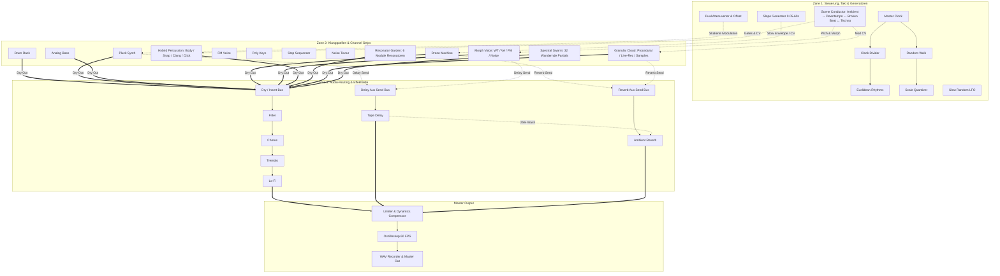

# ⚡ SYNTHBOARD STUDIO – Das vollständige Handbuch & Dokumentation

> **Modulares Ambient- & Beat-Rack im Browser**  
> Kombiniert freies, modulares Kabel-Patching (Clock, Gates, 1V/Okt Pitch CV und fließende Modulation) mit einer 3-Zonen-Architektur, parallelem Studio-Routing, interaktiver Kabel-Modulationstiefe, Parameter-Locks und einer frei sortierbaren Stereo-Effektkette.

---

## Inhaltsverzeichnis

1. [Überblick & Systemarchitektur](#1-überblick--systemarchitektur)
2. [Modulares Patch-Kabel-System & Modulationstiefe](#2-modulares-patch-kabel-system--modulationstiefe)
3. [Die 3 Rack-Zonen und der Signalfluss](#3-die-3-rack-zonen-und-der-signalfluss)
4. [Globale Performance-Features (Locks, Mutation, Velocity)](#4-globale-performance-features)
5. [Detailliertes Modul-Lexikon (Alle 30 Module)](#5-detailliertes-modul-lexikon-alle-30-module)
   - [A. Steuerung & Generatoren (Module 1–11)](#a-steuerung--generatoren)
   - [B. Klangquellen & Instrumente (Module 12–24)](#b-klangquellen--instrumente)
   - [C. Stereo-Effektkette (Module 25–30)](#c-stereo-effektkette)
6. [Interaktives Hilfesystem & Infoboxen](#6-interaktives-hilfesystem--infoboxen)
7. [Board-Verwaltung, Vorlagen, Aufnahme & Audio-Watchdog](#7-board-verwaltung-vorlagen-aufnahme--audio-watchdog)
8. [Praxis-Rezepte zum Nachbauen](#8-praxis-rezepte-zum-nachbauen)
9. [Tastatur-Kürzel & Schnellbedienung](#9-tastatur-kürzel--schnellbedienung)
10. [Technische Web-Audio-Architektur](#10-technische-web-audio-architektur)

---

## 1. Überblick & Systemarchitektur

SYNTHBOARD ist als modulares Studio-Rack konzipiert. Es trennt musikalische Steuerungslogik, Klangerzeugung und Klangverarbeitung in klar definierte Ebenen:

### Die Kernprinzipien von SYNTHBOARD
* **Keine starre Verdrahtung:** Jedes Instrument kann über Clock-, Gate- und Pitch-CV gesteuert, manuell gespielt oder völlig autonom moduliert werden.
* **Separates Studio-Aux-Routing:** Jede Klangquelle besitzt einen eigenen Channel-Strip mit **PAN**, **DELAY SEND** und **REVERB SEND**. Trockene Drums oder Bässe bleiben druckvoll im Zentrum, während Drones und Harfen im Raum schweben.
* **Sample-Akkurates Web Audio DSP:** Alle Synthese- und Modulationsberechnungen laufen latenzarm in 64-Bit-Gleitkomma direkt im Browser.

---

## 2. Modulares Patch-Kabel-System & Modulationstiefe

Das Patch-System simuliert ein physisches Hardware-Eurorack mit physikalisch animierten Kabeln, Farbkodierung und interaktiven Modulations-Abschwächern.

### Farbkodierung der Signale
| Signaltyp | Kabelfarbe | Beschreibung |
| :--- | :--- | :--- |
| **Clock / Trigger** | 🟡 Gelb / Gold | Schnelle Taktimpulse (z. B. `1/16`, `KICK IN`, `TRIG`). |
| **Gate** | 🟠 Orange | Hüllkurven-Tore mit Notenlänge (High/Low). |
| **Pitch (1V/Okt)** | 🔵 Blau | Chromatische Tonhöhensteuerung (1 Volt = 1 Oktave). |
| **Modulation / CV** | 🟢 Grün | Stufenlose Steuerspannungen (LFOs, Envelopes, Morph, Filter CV). |
| **Audio** | 🔴 Rot | Audio-Signale (z. B. Instrumenten-Outs, Resonator Audio IN). |

### Kabel stecken, trennen & ausblenden
1. **Kabel ziehen:** Klicke mit der linken Maustaste auf eine beliebige Buchse (Eingang oder Ausgang), halte gedrückt und ziehe das Kabel zur Gegenbuchse. Das Kabel rastet mit Klick-Sound ein.
2. **Kabel trennen:**
   - **Rechtsklick** auf eine belegte Buchse trennt die Verbindung sofort.
   - Alternativ das Kabelende mit der linken Maustaste greifen und ins Leere fallen lassen.
3. **Eurorack-Verbindungsregeln:**
   - **Ausgänge (OUT):** Dürfen ihr Signal an *beliebig viele* Eingänge gleichzeitig senden (Multing).
   - **Eingänge (IN):** Empfangen im Studio-Standard *genau 1* Signal zur Vermeidung von Pegel- und Phasenkonflikten.
4. **Kabel ausblenden:** 
   - Klicke oben auf **`KABEL`** (oder Taste **`C`**). Die Kabel werden transparent ausgeblendet, während alle Audio- und Modulationsverbindungen unbeeinflusst weiterlaufen.
5. **Automatisches Mitscrollen beim Kabelziehen:**
   - Wenn du ein Kabel von einer oberen Buchse nach unten ziehst (oder umgekehrt) und an den oberen/unteren Bildschirmrand fährst, scrollt das Arbeitsfeld automatisch sanft mit.
   - So kannst du auch auf kleineren Bildschirmen mühelos Module über mehrere Bildschirmhöhen hinweg verbinden.
6. **Arbeitsbereich-Zoom & Übersicht (`🔍−`, `100%`, `🔍＋`, `⤢ Fit`):**
   - **`⤢ Fit` (Einpassen):** Berechnet automatisch den perfekten Zoom-Faktor, damit alle drei Zonen (Steuerung, Instrumente, Effekte) vollständig auf deinen Monitor passen – ohne Scrollen.
   - **Stufenloser Zoom:** Von 45 % (Mega-Rack-Übersicht) bis 130 % (präzise Detailansicht) per Button, Tastatur (`+` / `-`) oder mit `Ctrl + Mausrad`.
   - **Modul-Bibliothek einklappen (`◀ Module` / Taste `B`):** Schafft zusätzlichen horizontalen Platz (bis zu 2400px Rack-Breite).

### Interaktive Kabel-Modulationstiefe (Depth 0–200 %)
Jedes Modulationskabel (`MOD`, grün) besitzt direkt auf dem Kabel ein interaktives Prozent-Badge:
* **Badge-Anzeige:** Zeigt die aktuelle Abschwächung bzw. Verstärkung des Signals (Standard: `100%`).
* **Mausrad:** Drehe das Rad über dem Badge, um den Wert präzise in 5%-Schritten von 0 % (stumm) bis 200 % (doppelte Auslenkung) zu trimmen.
* **Ziehen:** Halte die linke Maustaste auf dem Badge gedrückt und ziehe nach oben/unten.
* **Doppelklick:** Setzt die Modulationstiefe sofort wieder exakt auf den Standardwert `100%` zurück.
* **Persistenz:** Die Modulationstiefe wird beim Speichern in Presets und URL-Hashes mitgesichert.

---

## 3. Die 3 Rack-Zonen und der Signalfluss

Das Studio-Rack ist vertikal in drei Zonen unterteilt:

### Zone 1: Steuerung & Takt (Oberes Rack)
Beherbergt Master-Clock, Teiler, euklidische Rhythmen, Zufallsgeneratoren, Quantizer, LFOs und den **Scene Conductor**. Diese Module erzeugen keine Audiosignale, sondern musikalische Steuerspannungen (Clock, Gates, 1V/Okt Noten und fließende CVs).

### Zone 2: Klangquellen & Instrumente (Mittleres Rack)
Beherbergt alle 13 Instrumente (Drums, Bass, Pluck, FM, Drones, Keys, Morph Voice, Hybrid Percussion, Resonator Garden, Granular Cloud, Spectral Swarm etc.). Jedes Modul besitzt:
- Einen eigenen Lautstärkeregler (`LEVEL`).
- Einen individuellen Studio-Kanalzug mit **PAN**, **DELAY SEND** und **REVERB SEND**.
- Buchsen für **`VCA CV`** (Pegelmodulation) und **`PAN CV`** (Stereoraum-Modulation).

### Zone 3: Stereo-Effektkette & Master (Unteres Rack)
- **Insert-Kette:** Alle Instrumente fließen über den Dry-Bus sequenziell durch Filter ➜ Chorus ➜ Tremolo ➜ Lo-Fi Bitcrusher. Jedes Modul lässt sich einzeln bypassen (`AN / AUS`).
- **Parallele Aux-Busse:** Tape Delay und Ambient Reverb empfangen getrennte Send-Signale von jedem Instrument. 25 % des Tape-Delay-Echos werden zusätzlich in den Reverb gewaschen.
- **Master-Kanal:**
  - Stereo-Limiter & Soft-Clipper verhindern jegliche Übersteuerung.
  - Live-Oszilloskop mit 60 FPS in der Topbar.
  - Master-WAV-Recorder zum verlustfreien Mitschneiden.

---

## 4. Globale Performance-Features

### Parameter-Locks (`🔒`) & Musikalische Mutation (`🎲`)
Jedes der neuen Instrumente besitzt einen **`🎲 MUTIEREN`**-Taster sowie eine `MUTATE`-Triggerbuchse:
* **Musikalische Mutation:** Würfelt ungesperrte Klangregler um einen musikalischen Zufallsfaktor neu aus.
* **Parameter-Sperren (`🔒`):** Neben den Drehreglern befindet sich ein Schlosssymbol:
  - 🔓 *Offen:* Der Wert wird bei Klick auf *Mutieren* oder Gate an `MUTATE` verändert.
  - 🔒 *Gesperrt:* Der Parameter bleibt unberührt (z. B. Grundtonhöhe, Skala oder Filtertyp bleiben fest).
* **Automatisierte Mutation:** Patche einen Clock-Divider-Ausgang (z. B. `/16` oder `/32`) in die `MUTATE`-Buchse, um den Sound alle paar Takte subtil morphen zu lassen.

### Anschlagdynamik (Velocity)
Alle Instrumente unterstützen dynamische Noten-Anschläge (0 bis 127):
* Moduliert Hüllkurven-Amplituden, Filteröffnung und Resonanzverhalten.
* Bei **Hybrid Percussion** beeinflusst Velocity den Pitch-Drop und Attack-Punch.
* Bei **Morph Voice** steuert Velocity Sättigung und FM-Obertöne.

---

## 5. Detailliertes Modul-Lexikon (Alle 30 Module)

### A. Steuerung & Generatoren

#### 1. Master Clock (`⏱`)
* **Aufgabe:** Das rhythmische Herzstück des Racks. Erzeugt hochpräzise BPM-Takte.
* **Regler:** `BPM` (30–300 BPM), `Swing` (0–75 %).
* **Buchsen:** `RESET` (Eingang), `1/4`, `1/8`, `1/16`, `1/32` (Taktausgänge).

#### 2. Clock Divider (`➗`)
* **Aufgabe:** Teilt eingehende Takte für rhythmische Unterteilungen, langsame Wechsel und Songstrukturen.
* **Regler:** `Offset`.
* **Buchsen:** `CLOCK IN`, `RESET IN`, `/1`, `/2`, `/4`, `/8`, `/16`, `/32` (Geteilte Gate-Ausgänge).

#### 3. Euclidean Rhythms (`⭕`)
* **Aufgabe:** Erzeugt weltmusikalische, mathematisch gleichmäßig verteilte Rhythmen nach dem Euklid-Algorithmus.
* **Regler:** `Steps` (1–32), `Hits` (0–32), `Rotate` (0–31).
* **Optionen:** `Auflösung` (`1/16`, `1/8`, `1/4`).
* **Buchsen:** `CLOCK IN`, `RESET IN`, `GATE OUT`, `ACCENT OUT`.

#### 4. Probability Gate (`🎲`)
* **Aufgabe:** Zufälliger Takt-Filter (Bernoulli-Gate). Lässt eingehende Gates nur mit einer bestimmten Wahrscheinlichkeit passieren.
* **Regler:** `Chance` (0–100 %).
* **Buchsen:** `GATE IN`, `PROB CV`, `OUT A` (Erfolg), `OUT B` (Alternativ-Pfad).

#### 5. Random Walk (`🎲`)
* **Aufgabe:** Brown'sche Bewegung für Tonhöhen und Spannungen. Wandert in musikalischen Schritten auf und ab, statt rein zufällig zu springen.
* **Regler:** `Schrittweite` (1–12 Halbtöne), `Glättung` (Slew), `Dämpfung`, `Bereich`.
* **Buchsen:** `STEP IN`, `RESET IN`, `PITCH CV` (1V/Okt), `SMOOTH CV`.

#### 6. Scale Quantizer (`🎼`)
* **Aufgabe:** Zwingt beliebige stufenlose Steuerspannungen auf exakte Töne einer gewählten musikalischen Tonleiter.
* **Regler:** `Glide` (Portamento).
* **Optionen:** `Grundton` (C bis B), `Skala` (Pentatonik, Dur, Moll, Dorisch, Mixolydisch, Lydisch, Japanisch / Insen etc.).
* **Buchsen:** `CV IN`, `QUANT OUT` (1V/Okt), `TRIGGER OUT` (Impuls bei Tonhöhenwechsel).

#### 7. Slow Random LFO (`〰`)
* **Aufgabe:** Extrem langsame, nicht-zyklische Modulationsquelle für organisch wandernde Ambient-Klänge.
* **Regler:** `Rate` (0.01 bis 5.0 Hz), `Glättung`, `Chaos`.
* **Buchsen:** `RESET`, `SMOOTH CV`, `STEPPED CV` (Sample & Hold), `CHAOS CV`.

#### 8. Macro Controller (`🎛`)
* **Aufgabe:** Zentrale Master-Fernsteuerung für Live-Auftritte. Ein einziger großer Drehregler moduliert bis zu 4 verschiedene Ziele gleichzeitig.
* **Regler:** `Master Macro Knob` (0.00 bis 1.00), 4 individuelle Skalierungsregler (`A`, `B`, `C`, `D`).
* **Buchsen:** `OUT A`, `OUT B`, `OUT C`, `OUT D`.

#### 9. Slope Generator (`📈`)
* **Aufgabe:** Flexibler Funktionsgenerator für Anstiegs-/Abfallkurven (Attack/Decay-Hüllkurve, LFO oder Slew-Limiter).
* **Regler:** `Rise` (0.05s bis 60s), `Fall` (0.05s bis 60s), `Form` (Logarithmisch, Linear, Exponentiell).
* **Optionen:** Modus (`Trigger`, `Gate`, `Loop / LFO`).
* **Buchsen:** `TRIG IN`, `CV IN`, `RISE CV`, `FALL CV`, `ENV OUT`, `EOC OUT` (End of Cycle Impuls).

#### 10. Dual Attenuverter & Offset (`⚖`)
* **Aufgabe:** Abschwächer, Invertierer und Gleichspannungs-Offset für Steuersignale.
* **Regler:** `Scale A` (-1.0 bis +1.0), `Offset A`, `Scale B`, `Offset B`.
* **Buchsen:** `IN A`, `IN B`, `OUT A`, `OUT B`, `SUM OUT` (A + B).

#### 11. Scene Conductor (`🎬`)
* **Aufgabe:** Zentraler Dirigent für Live-Arrangements und Genre-Wechsel zwischen **Ambient** (weite Räume), **Downtempo** (weicher Beat & Bass), **Broken Beat** (synkopierte Percussion) und **Techno** (stramme 4/4 Kick und pulsierende Energie).
* **Regler & Optionen:**
  - `Stärke`, `Dichte`, `Variation`, `Mutation`.
  - `Wann`: Quantisierter Wechsel (`Sofort`, `Schlag`, `1 Takt`, `2 Takte`, `4 Takte`).
  - `Wie`: Überblendzeit (`Hart`, `1 Takt`, `2 Takte`, `4 Takte`, `8 Takte`).
  - `Lanes`: 4 Spuren (**Beat**, **Bass**, **Lead**, **Texture**) mit Mutes und Locks.
  - `FILL` & `BREAK`: Live-Buttons für Spontan-Fills und atmosphärische Drops.
* **Buchsen:** `CLOCK IN`, `NEXT SCENE`, `FILL`, `BREAK`, `MUTATE`, `KICK`, `SNARE`, `HAT`, `PERC`, `BASS GATE/PITCH`, `LEAD GATE/PITCH`, `X-FADE`, `SCENE CV`, `MOD 1`, `MOD 2`.

---

### B. Klangquellen & Instrumente

#### 12. Drone Machine (`🪐`)
* **Aufgabe:** 6-stimmiger additiver Oszillator für kosmische Drones und Akkordcluster.
* **Regler:** `Level`, `Tone`, `Spread` (Verstimmung), `FM`, `Drift`.
* **Pads:** 6 Oszillator-Schalter zum Ein-/Ausschalten einzelner Teiltöne.
* **Buchsen:** `GATE IN`, `FILTER CV`, `SPREAD CV`, `VCA CV`, `PAN CV`.

#### 13. Pluck Synth (`🪕`)
* **Aufgabe:** Karplus-Strong / Physical Modeling für akustische Harfen, Gitarren, Kalimbas und Glocken.
* **Regler:** `Level`, `Tone`, `Decay`, `Oberton`, `Body` (Resonanzkorpus).
* **Buchsen:** `GATE IN`, `PITCH IN`, `FILTER CV`, `VCA CV`, `PAN CV`.

#### 14. FM Voice (`🔔`)
* **Aufgabe:** 2-Operatoren FM-Synthese für kristalline Glocken, metallische Klänge und Rhodes-Sounds.
* **Regler:** `Level`, `Ratio` (Frequenzverhältnis), `Index` (FM-Helligkeit), `Attack`, `Decay`.
* **Buchsen:** `GATE IN`, `PITCH IN`, `FM INDEX CV`, `VCA CV`, `PAN CV`.

#### 15. Analog Bass (`⚡`)
* **Aufgabe:** Acid- und Sub-Bass Stimme mit transistor-modelliertem 24dB Tiefpassfilter.
* **Regler:** `Level`, `Cutoff`, `Resonanz`, `Env Mod`, `Decay`, `Glide`.
* **Optionen:** `Welle` (Sägezahn / Rechteck), `Sub-Oktave` (-1 Okt / -2 Okt).
* **Buchsen:** `GATE IN`, `PITCH IN`, `CUTOFF CV`, `VCA CV`, `PAN CV`.

#### 16. Drum Rack (`🥁`)
* **Aufgabe:** 4-Kanal analoger Drum-Computer (Kick, Snare, Hi-Hat, Percussion).
* **Regler:** `Kick Pitch`, `Kick Decay`, `Snare Snap`, `Snare Tune`, `HH Decay`, `Perc Pitch`.
* **Pads:** 4 spielbare Trigger-Taster.
* **Buchsen:** `KICK IN`, `SNARE IN`, `HH IN`, `PERC IN`, `VCA CV`, `PAN CV`.

#### 17. Poly Keys (`🎹`)
* **Aufgabe:** Polyphoner Synthesizer für üppige Pads, Chords und Lead-Melodien.
* **Regler:** `Level`, `Cutoff`, `Resonanz`, `Attack`, `Release`, `Detune`.
* **Optionen:** `Welle` (Dreieck, Sägezahn, Rechteck), `Skala`, `Grundton`, `Oktave`.
* **Live-Keyboard:** Kann direkt über Computertasten **`A`–`K`** gespielt werden.
* **Buchsen:** `GATE IN`, `PITCH IN`, `FILTER CV`, `VCA CV`, `PAN CV`.

#### 18. Step Sequencer (`∿`)
* **Aufgabe:** 8-Schritt Sequenzer für melodische Loops und Rhythmus-Muster.
* **Regler:** `Tempo`, `Swing`, `Gate Len`, `Decay` sowie 8 Step-Pitch-Knobs.
* **Optionen:** `Schritte` (1–8), `Skala`, `Grundton`, `Oktave`.
* **Buchsen:** `CLOCK IN`, `GATE OUT`, `PITCH OUT`, `VCA CV`, `PAN CV`.

#### 19. Noise Textur (`≋`)
* **Aufgabe:** Organischer Rauschgenerator für Meeresbrandung, Windheulen und Vinyl-Knistern.
* **Regler:** `Level`, `Tone`, `Reso`, `Wind`, `Speed`, `Vinyl`.
* **Optionen:** `Farbe` (Pink / Weiß), `Filter` (Lowpass, Bandpass, Highpass).
* **Buchsen:** `VCA CV`, `PAN CV`.

#### 20. Morph Voice (`🌀`)
* **Aufgabe:** Vielseitiges Flaggschiff-Instrument mit stufenlosem Morphing über 4 Synthesewelten: **Wavetable** (Sinus $\rightarrow$ Dreieck $\rightarrow$ Puls $\rightarrow$ Sägezahn), **Virtuell-Analog** (mit Sub-Oszillator), **FM-Synthese** und gefiltertem **Rauschgenerator**.
* **Besonderheiten:** Vokal-Formantfilter (A/E/I/O/U), Wavefolder-Sättigung, `JUMP`-Trigger für spontane Wellenform-Sprünge, Velocity und Parameter-Locks (`🔒`).
* **Regler:** `Level`, `Morph`, `Helligkeit`, `Formant`, `Rauheit`, `Verstimmung`, `Attack`, `Release`, `Stimmen`, `Sprung`, `Velocity`, `Mutation`.
* **Buchsen:** `GATE`, `PITCH`, `VEL`, `JUMP`, `MORPH CV`, `TIMBRE CV`, `ENV CV`, `VCA CV`, `PAN CV`, `MUTATE`, `OUT`.

#### 21. Hybrid Percussion (`🪘`)
* **Aufgabe:** Vierteilige Drum-Synthese-Engine:
  1. *Body*: Sinus/Dreieck-Oszillator mit Pitch-Drop für Kicks und Toms.
  2. *Snap*: Gefiltertes Rauschen für Snares und Shaker.
  3. *Clang*: Metallische Ringmodulatoren für Cowbells, Hats und Cymbals.
  4. *Click*: Transienter Attack-Impuls für druckvollen Durchsetzungs-Punch.
* **Interaktives UI:** 4 anschlagdynamische Live-Pads (`TIEF`, `TOM`, `SNARE`, `METALL`) mit Pegel-Animation.
* **Regler:** `Level`, `Tonhöhe`, `Körper`, `Material`, `Tonabfall`, `Rauschen`, `Anschlag`, `Länge`, `Verzerrung`, `Velocity`, `Mutation`.
* **Buchsen:** `TRIG 1–4`, `GATE`, `PITCH`, `ACCENT / VEL`, `MATERIAL CV`, `LENGTH CV`, `VCA CV`, `PAN CV`, `MUTATE`, `OUT`.

#### 22. Resonator Garden (`🔔`)
* **Aufgabe:** Physikalisch modellierte Resonanzbank aus 6 gestimmten Bandpass-Resonatoren. Simuliert Saiten, Marimbas, Glocken, Gongs und stehende Hallräume.
* **Anregung:** Interner Impuls/Rauschgenerator oder beliebige externe Audiosignale über `IN`.
* **Visualizer:** Integrierter Canvas visualisiert Schwingung und Abklingverhalten aller 6 Resonanzstäbe in Echtzeit.
* **Regler:** `Level`, `Material`, `Größe`, `Dämpfung`, `Anschlagposition`, `Verteilung` (Spread), `Ausklang`, `Resonanzen`, `Velocity`, `Mutation`.
* **Buchsen:** `IN` (Audio), `GATE`, `STRIKE`, `PITCH`, `VEL`, `SPREAD CV`, `MATERIAL CV`, `DAMP CV`, `VCA CV`, `PAN CV`, `MUTATE`, `OUT`.

#### 23. Granular Cloud (`☁`)
* **Aufgabe:** Zerlegt Audio in Mikrokörner (*Grains*, 10–500 ms) mit Hanning-Fensterung für dichte Ambient-Wolken, Vokal-Schwärme oder rhythmische Glitch-Partikel.
* **Quellen:** 4 prozedurale Generatoren (*Vocal Choir*, *Rain & Water*, *Prepared Piano*, *Machine Drone*), eigene Audio-Dateien (WAV/MP3/OGG via Drag & Drop) oder **Live-Master-Recording** (`● REC`).
* **Regler:** `Level`, `Position`, `Korngröße`, `Dichte`, `Tonhöhe`, `Rückwärts`, `Zeitstreuung`, `Stereobreite`, `Scan`, `Sprung`, `Freeze`, `Velocity`, `Mutation`.
* **Optionen:** `Spielweise` (`Cloud` für endlose Flächen, `Trigger` für Beat-Impulse).
* **Buchsen:** `GATE`, `JUMP`, `FREEZE`, `PITCH`, `POS CV`, `DENSITY CV`, `VCA CV`, `PAN CV`, `MUTATE`, `OUT`.

#### 24. Spectral Swarm (`✺`)
* **Aufgabe:** Additiver Schwarm-Synthesizer aus bis zu 32 unabhängigen Sinus-Teiltönen, die autonom durch Frequenz- und Phasenraum wandern.
* **Besonderheiten:**
  - `SCATTER`: Schleudert alle Partials chaotisch in den Frequenzraum.
  - `GATHER`: Zieht alle Partials synchron auf einen reinen harmonischen Grundakkord zusammen.
  - Orbit-Visualizer visualisiert Partikeldichte und Bewegung in Echtzeit.
* **Regler:** `Level`, `Teiltöne`, `Unharmonik`, `Streuung`, `Bewegung`, `Tiefe`, `Helligkeit`, `Zusammenhalt` (Cohesion), `Hüllkurve`, `Velocity`, `Mutation`.
* **Buchsen:** `GATE`, `PITCH`, `SCATTER`, `GATHER`, `COHESION CV`, `VCA CV`, `PAN CV`, `MUTATE`, `OUT`.

---

### C. Stereo-Effektkette

#### 25. Analog Filter (`⌇`)
* **Aufgabe:** 24dB-Multimode-Filter mit transistor-modellierter Sättigung (`Drive`) und internem LFO.
* **Regler:** `Cutoff`, `Resonanz`, `Drive`, `LFO Rate`, `LFO Tiefe`.
* **Optionen:** Typ (`Lowpass`, `Highpass`, `Bandpass`).
* **Buchsen:** `CUTOFF CV` (Externe Filtermodulation).

#### 26. Stereo Chorus (`🌊`)
* **Aufgabe:** Räumliche Stereobreite, Schwebungen und Ensemble-Verdopplung.
* **Regler:** `Rate`, `Tiefe`, `Delay`, `Mix`.

#### 27. Tremolo (`〰`)
* **Aufgabe:** Periodische Lautstärkemodulation für Vintage- und Pulsing-Effekte.
* **Regler:** `Rate`, `Tiefe`.

#### 28. Lo-Fi Bitcrusher (`📼`)
* **Aufgabe:** Digitale Bit-Reduktion, Sampleraten-Dezimierung und Kassetten-Tonband-Flutter.
* **Regler:** `Bits` (1–16 Bit), `Sample Rate`, `Drive`, `Flutter`, `Mix`.

#### 29. Tape Delay (`🪞`)
* **Aufgabe:** Analog modelliertes Bandecho mit getrennten Stereopfaden und Filterdämpfung.
* **Regler:** `Zeit`, `Feedback`, `Tone`, `Wobble`, `Mix`.
* **Optionen:** Modus (`Stereo` / `Ping-Pong`).
* **Buchsen:** `TIME CV` (Tape-Warping und Pitch-Drift).

#### 30. Ambient Reverb (`✨`)
* **Aufgabe:** Tief shimmernder Hallraum mit dichter Reflexionswolke für endlose Räume (bis 20s Decay).
* **Regler:** `Decay`, `Dämpfung`, `Pre-Delay`, `Tone`, `Mix`.

---

## 6. Interaktives Hilfesystem & Infoboxen

1. **Infoboxen Ein/Aus (`INFO: AN / AUS`):**
   - Schalter in der Topbar oder über Tastenkürzel **`I`**.
   - Hover über eine Buchse blendet ein schwebendes Glas-Panel mit Signalart, Typ (IN/OUT), Erklärung und aktiven Verbindungen ein.
   - Hover über Regler erklärt deren physikalische und klangliche Auswirkung.
2. **Modul-Hilfe (`?`):**
   - Jede Modulkarte verfügt über einen `?`-Button in der Titelleiste, der das Handbuch direkt an der passenden Stelle öffnet.
3. **Suchfunktion:**
   - Volltextsuche und Kategorie-Filter (`Alle`, `Steuerung`, `Klangquellen`, `Effekte`) direkt im Handbuch-Dialog.

---

## 7. Board-Verwaltung, Vorlagen, Aufnahme & Audio-Watchdog

* **Vorlagen (Templates):**
  - `🎬 Szenen-Wechsel (Ambient ↔ Beats)`: Vollständiges Performance-Setup mit Scene Conductor, Hybrid Percussion, Morph Voice, Granular Cloud und Spectral Swarm.
  - `Generatives Ambient`: Schwebende generative Harfen und beruhigende Flächen.
  - `Solar Drone Desk`: Tiefe Kosmos-Drones und modulierter analoger Bass.
  - `Ambient Sequenz`: Melodische Steps mit Delay- und Reverb-Waschungen.
  - `Lo-Fi Keys & FM`: Warme E-Piano-Akkorde und digitale Glöckchen.
  - `Leeres Board`: Freie Arbeitsfläche zum eigenen Rack-Aufbau von Grund auf.
* **Speichern & Teilen:**
  - Eigene Boards speichern (`💾 Speichern`) oder duplizieren (`⧉ Kopie`).
  - **Export / Import:** Board als `.json`-Datei herunterladen (`⇩`) oder von der Festplatte einlesen (`⇧`).
  - URL-Sharing: Alle Verbindungen und Reglerstände werden komprimiert im URL-Hash gespeichert.
* **Master-WAV-Recorder (`● REC`):**
  - Unkomprimierte 32-Bit Float Studioaufnahme direkt aus der Master-Summe.
  - Klick auf `STOP` speichert die Audiodatei sofort lokal ab.
* **Audio-Watchdog (Überlaufschutz):**
  - Überwacht die Master-Summe kontinuierlich auf `NaN`, Signalabrisse oder endlose Feedback-Schleifen.
  - Setzt die Audio-Engine bei Ausnahmefällen sanft zurück, ohne die Oberfläche neu laden zu müssen.

---

## 8. Praxis-Rezepte zum Nachbauen

### 🌿 Rezept 1: Generative Ambient-Harfe
1. Füge **Master Clock**, **Euclidean Rhythm**, **Random Walk** und **Pluck Synth** hinzu.
2. Verbinde `Master Clock: 1/16` ➜ `Euclidean: CLOCK IN`.
3. Verbinde `Euclidean: GATE OUT` ➜ `Random Walk: STEP IN`.
4. Verbinde `Random Walk: PITCH CV` ➜ `Pluck Synth: PITCH IN`.
5. Verbinde `Euclidean: GATE OUT` ➜ `Pluck Synth: GATE IN`.
6. Schalte **Tape Delay** und **Ambient Reverb** in der Effektkette ein.
*Ergebnis:* Ein zeitloses, wunderschönes Zupfmuster, das sich nie exakt wiederholt.

### 🎬 Rezept 2: Nahtloser Szenen-Wechsel (Ambient ↔ Downtempo ↔ Techno)
1. Füge **Master Clock**, **Scene Conductor**, **Hybrid Percussion** und **Morph Voice** hinzu.
2. Verbinde `Master Clock: 1/16` ➜ `Scene Conductor: CLOCK IN`.
3. Verbinde `Conductor: KICK` ➜ `Hybrid Percussion: TRIG 1`.
4. Verbinde `Conductor: SNARE` ➜ `Hybrid Percussion: TRIG 2`.
5. Verbinde `Conductor: LEAD PITCH` ➜ `Morph Voice: PITCH`.
6. Verbinde `Conductor: LEAD GATE` ➜ `Morph Voice: GATE`.
7. Verbinde `Conductor: X-FADE` ➜ `Morph Voice: MORPH CV`.
8. Schalte mit den Szenen-Tastern zwischen *Ambient*, *Downtempo*, *Broken Beat* und *Techno* um.
*Ergebnis:* Perfekt quantisierte Taktwechsel mit butterweichem Klangfarben-Crossfade.

### ☁ Rezept 3: Organischer Glitch-Beat (Hybrid Drums + Granular Cloud)
1. `Conductor: KICK` & `SNARE` ➜ **Hybrid Percussion**.
2. Klicke auf der **Granular Cloud** auf `● REC`, um 4 Sekunden Master-Beat einzufangen.
3. Verbinde `Clock Divider: /8` ➜ `Granular Cloud: JUMP`.
4. Verbinde `Slow Random LFO` ➜ `Granular Cloud: POS CV` (Kabeltiefe auf `60%`).
*Ergebnis:* Der Beat wird in mikroskopische Partikel zerlegt, die als rhythmische Geister-Echos durch das Stereofeld wandern.

### 🔔 Rezept 4: Schwebender Resonanz-Garten (Resonator Garden + Random Walk)
1. Verbinde `Master Clock: 1/8` ➜ `Resonator Garden: STRIKE`.
2. Verbinde `Random Walk: PITCH CV` ➜ `Resonator Garden: PITCH`.
3. Verbinde `Slow Random LFO` ➜ `Resonator Garden: SPREAD CV` (Kabeltiefe auf `140%`).
4. Drehe am Resonator Garden den **REVERB SEND** auf 80%.
*Ergebnis:* Gamelan- und Harfen-Resonanzen mit organisch driftenden Oberton-Akkorden.

### 🌌 Rezept 5: Lebendiger Vokal-Chor (Morph Voice + Spectral Swarm)
1. Sequenzer `PITCH` ➜ `Morph Voice: PITCH` und `Spectral Swarm: PITCH`.
2. `Slope Generator: ENV OUT` ➜ `Morph Voice: TIMBRE CV` (Formant-Modulation).
3. Verbinde `Clock Divider: /16` ➜ `Spectral Swarm: SCATTER`.
4. Verbinde `Clock Divider: /32` ➜ `Spectral Swarm: GATHER`.
*Ergebnis:* Eine tragende Gesangsstimme, umgeben von einem Vokal-Schwarm, der sich rhythmisch im Raum auflöst und wieder zusammenfindet.

---

## 9. Tastatur-Kürzel & Schnellbedienung

| Taste | Funktion |
| :--- | :--- |
| **`+`** / **`-`** | **Arbeitsbereich vergrößern / verkleinern** (Zoom In / Out) |
| **`0`** | **Zoom auf 100 % zurücksetzen** |
| **`F`** | **Ganzes Rack auf den Bildschirm einpassen** (Fit to Screen) |
| **`B`** | **Modul-Bibliothek ein-/ausklappen** (Maximale Rack-Breite freigeben) |
| **`I`** | **Infoboxen an- / ausschalten** (Hover-Tooltips für Buchsen & Regler) |
| **`H`** oder **`?`** | **Studio-Handbuch öffnen / schließen** |
| **`C`** | **Patch-Kabel ein- / ausblenden** |
| **`A` bis `K`** | **Poly Keys Synthesizer** direkt auf der Computertastatur spielen |
| **`Esc`** | Handbuch oder geöffnete modale Dialoge schließen |
| **`Ctrl` + Mausrad** | Stufenloser Zoom direkt über dem Rack |
| **Doppelklick auf Regler** | Regler sofort auf seinen Standardwert zurücksetzen |
| **Doppelklick auf Kabel-Badge** | Modulations-Kabeltiefe auf exakt 100 % zurücksetzen |
| **Mausrad über Kabel-Badge** | Modulationstiefe stufenlos in 5%-Schritten trimmen |
| **Rechtsklick auf Buchse** | Patch-Kabel sofort von der Buchse trennen |

---

## 10. Technische Web-Audio-Architektur

- **Knoten-Graphen:** Pure Web Audio API Nodes (`OscillatorNode`, `BiquadFilterNode`, `GainNode`, `WaveShaperNode`, `ConvolverNode`, `AudioBufferSourceNode`) ohne externe schwere Bibliotheken.
- **Granular-Engine:** Hanning-gefensterte Grain-Buffer mit dynamischem Scheduling im Vorgriff-Zeitfenster (Lookahead 25 ms) für jitterfreie Performance bei bis zu 24 parallelen Partikeln.
- **Modale Filter:** Kaskadierte Resonanz-Bandpässe mit exponentieller Frequenzspreizung (`f_n = f_0 * (1 + spread * n)^alpha`).
- **Signal-Integrität:** Kontinuierliche Überwachung durch den Audio-Watchdog zur Prävention von Rechenüberläufen (`NaN` / `Infinity`).

---

*SYNTHBOARD Studio © 2026 – Modulares Musikstudio & Synthesizer im Browser*
