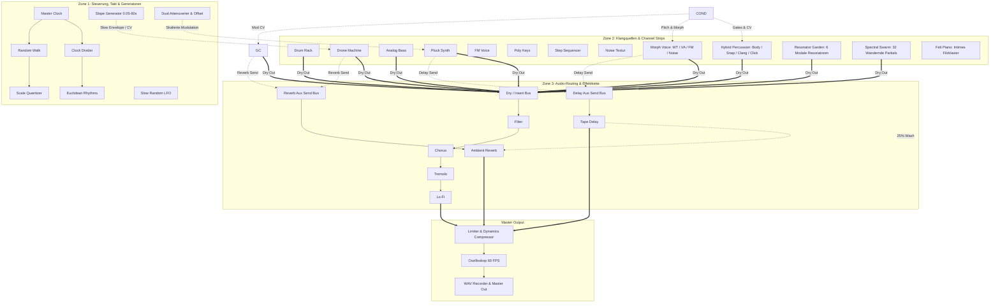

# ⚡ SYNTHBOARD STUDIO – Das vollständige Handbuch & Dokumentation

> **Modulares Ambient- & Beat-Rack im Browser**  
> Kombiniert freies, modulares Kabel-Patching (Clock, Gates, 1V/Okt Pitch CV und fließende Modulation) mit einer 3-Zonen-Architektur, parallelem Studio-Routing, interaktiver Kabel-Modulationstiefe, Parameter-Locks und einer frei sortierbaren Stereo-Effektkette.

---

## Inhaltsverzeichnis

1. [Überblick & Systemarchitektur](#1-überblick--systemarchitektur)
2. [Modulares Patch-Kabel-System & Modulationstiefe](#2-modulares-patch-kabel-system--modulationstiefe)
3. [Die 3 Rack-Zonen und der Signalfluss](#3-die-3-rack-zonen-und-der-signalfluss)
4. [Globale Performance-Features (Locks, Mutation, Velocity)](#4-globale-performance-features)
5. [Detailliertes Modul-Lexikon (Alle 30 Module)](#5-detailliertes-modul-lexikon-alle-30-module)
   - [A. Steuerung & Generatoren (Module 1–11)](#a-steuerung--generatoren)
   - [B. Klangquellen & Instrumente (Module 12–24)](#b-klangquellen--instrumente)
   - [C. Stereo-Effektkette (Module 25–30)](#c-stereo-effektkette)
6. [Interaktive Modul-Tutorials & Der Grüne Modulations-Guide (CV-Spannungen)](#6-interaktive-modul-tutorials--der-grüne-modulations-guide)
7. [Board-Verwaltung, Vorlagen, Aufnahme & Audio-Watchdog](#7-board-verwaltung-vorlagen-aufnahme--audio-watchdog)
8. [Praxis-Rezepte zum Nachbauen](#8-praxis-rezepte-zum-nachbauen)
9. [Tastatur-Kürzel & Schnellbedienung](#9-tastatur-kürzel--schnellbedienung)
10. [Technische Web-Audio-Architektur](#10-technische-web-audio-architektur)

---

## 1. Überblick & Systemarchitektur

SYNTHBOARD ist als modulares Studio-Rack konzipiert. Es trennt musikalische Steuerungslogik, Klangerzeugung und Klangverarbeitung in klar definierte Ebenen:

### Die Kernprinzipien von SYNTHBOARD
* **Keine starre Verdrahtung:** Jedes Instrument kann über Clock-, Gate- und Pitch-CV gesteuert, manuell gespielt oder völlig autonom moduliert werden.
* **Separates Studio-Aux-Routing:** Jede Klangquelle besitzt einen eigenen Channel-Strip mit **PAN**, **DELAY SEND** und **REVERB SEND**. Trockene Drums oder Bässe bleiben druckvoll im Zentrum, während Drones und Harfen im Raum schweben.
* **Sample-Akkurates Web Audio DSP:** Alle Synthese- und Modulationsberechnungen laufen latenzarm in 64-Bit-Gleitkomma direkt im Browser.

---

## 2. Modulares Patch-Kabel-System & Modulationstiefe

Das Patch-System simuliert ein physisches Hardware-Eurorack mit physikalisch animierten Kabeln, Farbkodierung und interaktiven Modulations-Abschwächern.

### Farbkodierung der Signale
| Signaltyp | Kabelfarbe | Beschreibung |
| :--- | :--- | :--- |
| **Clock / Trigger** | 🟡 Gelb / Gold | Schnelle Taktimpulse (z. B. `1/16`, `KICK IN`, `TRIG`). |
| **Gate** | 🟠 Orange | Hüllkurven-Tore mit Notenlänge (High/Low). |
| **Pitch (1V/Okt)** | 🔵 Blau | Chromatische Tonhöhensteuerung (1 Volt = 1 Oktave). |
| **Modulation / CV** | 🟢 Grün | Stufenlose Steuerspannungen (LFOs, Envelopes, Morph, Filter CV). |
| **Audio** | 🔴 Rot | Audio-Signale (z. B. Instrumenten-Outs, Resonator Audio IN). |

### Kabel stecken, trennen & ausblenden
1. **Kabel ziehen:** Klicke mit der linken Maustaste auf eine beliebige Buchse (Eingang oder Ausgang), halte gedrückt und ziehe das Kabel zur Gegenbuchse. Das Kabel rastet mit Klick-Sound ein.
2. **Kabel trennen:**
   - **Rechtsklick** auf eine belegte Buchse trennt die Verbindung sofort.
   - Alternativ das Kabelende mit der linken Maustaste greifen und ins Leere fallen lassen.
3. **Eurorack-Verbindungsregeln:**
   - **Ausgänge (OUT):** Dürfen ihr Signal an *beliebig viele* Eingänge gleichzeitig senden (Multing).
   - **Eingänge (IN):** Empfangen im Studio-Standard *genau 1* Signal zur Vermeidung von Pegel- und Phasenkonflikten.
4. **Kabel ausblenden:** 
   - Klicke oben auf **`KABEL`** (oder Taste **`C`**). Die Kabel werden transparent ausgeblendet, während alle Audio- und Modulationsverbindungen unbeeinflusst weiterlaufen.
5. **Automatisches Mitscrollen beim Kabelziehen:**
   - Wenn du ein Kabel von einer oberen Buchse nach unten ziehst (oder umgekehrt) und an den oberen/unteren Bildschirmrand fährst, scrollt das Arbeitsfeld automatisch sanft mit.
   - So kannst du auch auf kleineren Bildschirmen mühelos Module über mehrere Bildschirmhöhen hinweg verbinden.
6. **Arbeitsbereich-Zoom & Übersicht (`🔍−`, `100%`, `🔍＋`, `⤢ Fit`):**
   - **`⤢ Fit` (Einpassen):** Berechnet automatisch den perfekten Zoom-Faktor, damit alle drei Zonen (Steuerung, Instrumente, Effekte) vollständig auf deinen Monitor passen – ohne Scrollen.
   - **Stufenloser Zoom:** Von 45 % (Mega-Rack-Übersicht) bis 130 % (präzise Detailansicht) per Button, Tastatur (`+` / `-`) oder mit `Ctrl + Mausrad`.
   - **Modul-Bibliothek einklappen (`◀ Module` / Taste `B`):** Schafft zusätzlichen horizontalen Platz (bis zu 2400px Rack-Breite).

### Interaktive Kabel-Modulationstiefe (Depth 0–200 %)
Jedes Modulationskabel (`MOD`, grün) besitzt direkt auf dem Kabel ein interaktives Prozent-Badge:
* **Badge-Anzeige:** Zeigt die aktuelle Abschwächung bzw. Verstärkung des Signals (Standard: `100%`).
* **Mausrad:** Drehe das Rad über dem Badge, um den Wert präzise in 5%-Schritten von 0 % (stumm) bis 200 % (doppelte Auslenkung) zu trimmen.
* **Ziehen:** Halte die linke Maustaste auf dem Badge gedrückt und ziehe nach oben/unten.
* **Doppelklick:** Setzt die Modulationstiefe sofort wieder exakt auf den Standardwert `100%` zurück.
* **Persistenz:** Die Modulationstiefe wird beim Speichern in Presets und URL-Hashes mitgesichert.

---

## 3. Die 3 Rack-Zonen und der Signalfluss

Das Studio-Rack ist vertikal in drei Zonen unterteilt:

### Zone 1: Steuerung & Takt (Oberes Rack)
Beherbergt Master-Clock, Teiler, euklidische Rhythmen, Zufallsgeneratoren, Quantizer, LFOs und den **Scene Conductor**. Diese Module erzeugen keine Audiosignale, sondern musikalische Steuerspannungen (Clock, Gates, 1V/Okt Noten und fließende CVs).

### Zone 2: Klangquellen & Instrumente (Mittleres Rack)
Beherbergt alle 13 Instrumente (Drums, Bass, Pluck, FM, Drones, Keys, Morph Voice, Hybrid Percussion, Resonator Garden, Granular Cloud, Spectral Swarm etc.). Jedes Modul besitzt:
- Einen eigenen Lautstärkeregler (`LEVEL`).
- Einen individuellen Studio-Kanalzug mit **PAN**, **DELAY SEND** und **REVERB SEND**.
- Buchsen für **`VCA CV`** (Pegelmodulation) und **`PAN CV`** (Stereoraum-Modulation).

### Zone 3: Stereo-Effektkette & Master (Unteres Rack)
- **Insert-Kette:** Alle Instrumente fließen über den Dry-Bus sequenziell durch Filter ➜ Chorus ➜ Tremolo ➜ Lo-Fi Bitcrusher. Jedes Modul lässt sich einzeln bypassen (`AN / AUS`).
- **Parallele Aux-Busse:** Tape Delay und Ambient Reverb empfangen getrennte Send-Signale von jedem Instrument. 25 % des Tape-Delay-Echos werden zusätzlich in den Reverb gewaschen.
- **Master-Kanal:**
  - Stereo-Limiter & Soft-Clipper verhindern jegliche Übersteuerung.
  - Live-Oszilloskop mit 60 FPS in der Topbar.
  - Master-WAV-Recorder zum verlustfreien Mitschneiden.

---

## 4. Globale Performance-Features

### Parameter-Locks (`🔒`) & Musikalische Mutation (`🎲`)
Jedes der neuen Instrumente besitzt einen **`🎲 MUTIEREN`**-Taster sowie eine `MUTATE`-Triggerbuchse:
* **Musikalische Mutation:** Würfelt ungesperrte Klangregler um einen musikalischen Zufallsfaktor neu aus.
* **Parameter-Sperren (`🔒`):** Neben den Drehreglern befindet sich ein Schlosssymbol:
  - 🔓 *Offen:* Der Wert wird bei Klick auf *Mutieren* oder Gate an `MUTATE` verändert.
  - 🔒 *Gesperrt:* Der Parameter bleibt unberührt (z. B. Grundtonhöhe, Skala oder Filtertyp bleiben fest).
* **Automatisierte Mutation:** Patche einen Clock-Divider-Ausgang (z. B. `/16` oder `/32`) in die `MUTATE`-Buchse, um den Sound alle paar Takte subtil morphen zu lassen.

### Anschlagdynamik (Velocity)
Alle Instrumente unterstützen dynamische Noten-Anschläge (0 bis 127):
* Moduliert Hüllkurven-Amplituden, Filteröffnung und Resonanzverhalten.
* Bei **Hybrid Percussion** beeinflusst Velocity den Pitch-Drop und Attack-Punch.
* Bei **Morph Voice** steuert Velocity Sättigung und FM-Obertöne.

---

## 5. Detailliertes Modul-Lexikon (Alle 30 Module)

### A. Steuerung & Generatoren

#### 1. Master Clock (`⏱`)
* **Aufgabe:** Das rhythmische Herzstück des Racks. Erzeugt hochpräzise BPM-Takte.
* **Regler:** `BPM` (30–300 BPM), `Swing` (0–75 %).
* **Buchsen:** `RESET` (Eingang), `1/4`, `1/8`, `1/16`, `1/32` (Taktausgänge).
* **Praxis-Beispiel:** Verbinde `Clock 1/16` mit `Euclidean (CLOCK IN)` und `Clock Divider (CLOCK IN)` ➔ Taktet dein gesamtes Board synchron im 4/4-Takt.

#### 2. Clock Divider (`➗`)
* **Aufgabe:** Teilt eingehende Takte für rhythmische Unterteilungen, langsame Wechsel und Songstrukturen.
* **Regler:** `Offset`.
* **Buchsen:** `CLOCK IN`, `RESET IN`, `/1`, `/2`, `/4`, `/8`, `/16`, `/32` (Geteilte Gate-Ausgänge).
* **Praxis-Beispiel:** Verbinde `/4` mit `Drum Rack (KICK)` und `/8` mit `Drum Rack (SNARE)` ➔ Ergibt einen soliden 4-on-the-Floor Club-Groove.

#### 3. Euclidean Rhythms (`⭕`)
* **Aufgabe:** Erzeugt weltmusikalische, mathematisch gleichmäßig verteilte Rhythmen nach dem Euklid-Algorithmus.
* **Regler:** `Steps` (1–32), `Hits` (0–32), `Rotate` (0–31).
* **Optionen:** `Auflösung` (`1/16`, `1/8`, `1/4`).
* **Buchsen:** `CLOCK IN`, `RESET IN`, `GATE OUT`, `ACCENT OUT`.
* **Praxis-Beispiel:** Stelle `Steps=7` und `Hits=3` ein und verbinde `GATE OUT` mit `Pluck Synth (GATE IN)` ➔ Ergibt ein hypnotisches, versetztes Polyrhythmus-Zupfmuster.

#### 4. Probability Gate (`🎲`)
* **Aufgabe:** Zufälliger Takt-Filter (Bernoulli-Gate). Lässt eingehende Gates nur mit einer bestimmten Wahrscheinlichkeit passieren.
* **Regler:** `Chance` (0–100 %).
* **Buchsen:** `GATE IN`, `PROB CV`, `OUT A` (Erfolg), `OUT B` (Alternativ-Pfad).
* **Praxis-Beispiel:** Leite den Hi-Hat-Takt durch das Probability Gate (`Chance 60%`) ➔ Erzeugt lebendige, unvorhersehbar aussetzende Human-Hi-Hats.

#### 5. Random Walk (`🎲`)
* **Aufgabe:** Brown'sche Bewegung für Tonhöhen und Spannungen. Wandert in musikalischen Schritten auf und ab, statt rein zufällig zu springen.
* **Regler:** `Schrittweite` (1–12 Halbtöne), `Glättung` (Slew), `Dämpfung`, `Bereich`.
* **Buchsen:** `STEP IN`, `RESET IN`, `PITCH CV` (1V/Okt), `SMOOTH CV`.
* **Praxis-Beispiel:** Verbinde `PITCH CV` mit `Pluck Synth (PITCH IN)` und `STEP IN` mit `Euclidean (GATE OUT)` ➔ Erzeugt endlose, meditative Harfenläufe, die nie schief klingen.

#### 6. Scale Quantizer (`🎼`)
* **Aufgabe:** Zwingt beliebige stufenlose Steuerspannungen auf exakte Töne einer gewählten musikalischen Tonleiter.
* **Regler:** `Glide` (Portamento).
* **Optionen:** `Grundton` (C bis B), `Skala` (Pentatonik, Dur, Moll, Dorisch, Mixolydisch, Lydisch, Japanisch / Insen etc.).
* **Buchsen:** `CV IN`, `QUANT OUT` (1V/Okt), `TRIGGER OUT` (Impuls bei Tonhöhenwechsel).
* **Praxis-Beispiel:** Speise `Slow Random (CV OUT)` in den Quantizer und verbinde `QUANT OUT` mit `Keys (PITCH IN)` ➔ Verwandelt stufenloses LFO-Driften in eine saubere Melodiefolge.

#### 7. Slow Random LFO (`〰`)
* **Aufgabe:** Extrem langsame, nicht-zyklische Modulationsquelle für organisch wandernde Ambient-Klänge.
* **Regler:** `Rate` (0.01 bis 5.0 Hz), `Glättung`, `Chaos`.
* **Buchsen:** `RESET`, `SMOOTH CV`, `STEPPED CV` (Sample & Hold), `CHAOS CV`.
* **Praxis-Beispiel:** Verbinde `CV OUT` mit `Filter (CUTOFF CV)` ➔ Das Filter öffnet und schließt sich sanft wie das Atmen von Meereswellen.

#### 8. Macro Controller (`🎛`)
* **Aufgabe:** Zentrale Master-Fernsteuerung für Live-Auftritte. Drei globale Steuerachsen (Dichte, Variation, Bewegung) für händische Performance.
* **Regler:** `Dichte`, `Variation`, `Bewegung`, `Seed`.
* **Buchsen:** `DICHTE CV`, `VARIATION CV`, `BEWEGUNG CV`.
* **Praxis-Beispiel:** Verbinde `DICHTE CV` mit `Granular Cloud (DENSITY CV)` und `BEWEGUNG CV` mit `Filter (CUTOFF CV)` ➔ Ein Reglergriff lässt die gesamte Klangwolke aufblühen.

#### 9. Slope Generator (`📈`)
* **Aufgabe:** Flexibler Funktionsgenerator für Anstiegs-/Abfallkurven (0.05s bis 60s Hüllkurve, LFO oder Slew-Limiter).
* **Regler:** `Rise` (0.05s bis 60s), `Fall` (0.05s bis 60s).
* **Optionen:** Modus (`Loop`, `Trig`, `Gate`).
* **Buchsen:** `TRIG IN`, `GATE IN`, `RISE CV`, `FALL CV`, `ENV OUT`, `INV OUT`, `EOC OUT`.
* **Praxis-Beispiel:** Verbinde `ENV OUT` mit `Drone (VCA CV)` und `INV OUT` mit `Pluck (VCA CV)` ➔ Bis zu 60s langer Ambient-Swell mit automatischem Sidechain-Ducking der Zupftöne.

#### 10. Dual Attenuverter & Offset (`⚖`)
* **Aufgabe:** Abschwächer, Invertierer und Gleichspannungs-Offset für Steuersignale.
* **Regler:** `Scale A` (-1.0 bis +1.0), `Offset A`, `Scale B`, `Offset B`.
* **Buchsen:** `IN A`, `IN B`, `OUT A`, `OUT B`, `SUM OUT` (A + B).
* **Praxis-Beispiel:** LFO in `IN A` ➔ `Scale A` auf `20%` ➔ `OUT A` an `Filter (CUTOFF CV)` ➔ Bändigt zu wilde Filtersprünge auf ein feines, seidiges Glänzen.

---

### B. Klangquellen & Instrumente

#### 11. Drone Machine (`🪐`)
* **Aufgabe:** 6-stimmiger additiver Oszillator für kosmische Drones und Akkordcluster mit 6 einzelnen Stummschaltern.
* **Regler:** `Level`, `Tone`, `Detune`, `Sub`, `FM`, `Drift`.
* **Buchsen:** `VCA CV`, `PAN CV`, `FM CV`, `TONE CV`.
* **Praxis-Beispiel:** Verbinde `Slope Generator (ENV OUT)` mit `VCA CV` und drehe `REVERB SEND` auf 80 % ➔ Erzeugt einen epischen 40-Sekunden Weltraum-Flächen-Swell.

#### 12. Pluck Synth (`🪕`)
* **Aufgabe:** Karplus-Strong Physical Modeling für akustische Harfen, Gitarren, Kalimbas und Glocken.
* **Regler:** `Level`, `Tone`, `Decay`, `Oberton`, `Body`.
* **Buchsen:** `GATE IN`, `PITCH IN`, `FILTER CV`, `VCA CV`, `PAN CV`.
* **Praxis-Beispiel:** `Euclidean (TRIG)` ➔ `Pluck (GATE IN)`, `Random Walk (PITCH)` ➔ `Pluck (PITCH IN)` ➔ Traumhafte, nie endende Harfenmelodien.

#### 13. FM Voice (`🔔`)
* **Aufgabe:** 2-Operatoren FM-Synthese für kristalline Glocken, metallische Klänge und Rhodes-Sounds.
* **Regler:** `Level`, `Ratio`, `Mod Index`, `Decay`, `Tone`.
* **Buchsen:** `GATE IN`, `PITCH IN`, `INDEX CV`, `VCA CV`, `PAN CV`.
* **Praxis-Beispiel:** Verbinde `Slow Random (CV OUT)` mit `INDEX CV` ➔ Die Glockenklänge morpht von reinem Rhodes zu strahlend metallischem Gamelan.

#### 14. Analog Bass (`⚡`)
* **Aufgabe:** Acid- und Sub-Bass Stimme mit transistor-modelliertem 24dB Tiefpassfilter.
* **Regler:** `Level`, `Cutoff`, `Resonanz`, `Env Mod`, `Decay`, `Sub`.
* **Buchsen:** `GATE IN`, `PITCH IN`, `CUTOFF CV`, `VCA CV`, `PAN CV`.
* **Praxis-Beispiel:** `Clock Divider (/2)` ➔ `Bass (GATE IN)`, `Slow Random` ➔ `Bass (CUTOFF CV)` ➔ Warmer, drückender Subbass.

#### 15. Drum Rack (`🥁`)
* **Aufgabe:** 4-Kanal analoger Drum-Computer (Kick, Snare, Hi-Hat, Percussion).
* **Regler:** `Master`, `Kick Dec`, `Snare Snappy`, `Hat Dec`, `Perc Tune`.
* **Buchsen:** `KICK IN`, `SNARE IN`, `HAT IN`, `PERC IN`, `VCA CV`, `PAN CV`.
* **Praxis-Beispiel:** Verbinde `Master Clock div4Out` mit `KICK IN` und `Clock Divider div2Out` mit `SNARE IN`.

#### 16. Touch Keys (`🎹`)
* **Aufgabe:** Polyphoner Synthesizer für üppige Pads, Chords und Lead-Melodien (auch per Computertastatur **`A`–`K`** spielbar).
* **Regler:** `Level`, `Cutoff`, `Reso`, `Attack`, `Release`, `Detune`.
* **Buchsen:** `GATE IN`, `PITCH IN`, `CUTOFF CV`, `RECORD`, `VCA CV`, `PAN CV`.

#### 17. Step Sequencer (`∿`)
* **Aufgabe:** 8-Schritt Sequenzer für melodische Loops mit eigener analoger Synth-Stimme und Gate-/Pitch-Ausgängen.
* **Step-Pausen (Muting):** Jeder der 8 Steps besitzt unter der Note einen Schalter (`seq-toggle`), mit dem er stummgeschaltet werden kann (Pause ohne Gate/Audio).
* **Regler:** `Tempo`, `Level`, `Decay`, `Cutoff`, `Reso`, `Env`, `Chance`.
* **Buchsen:** `CLOCK IN`, `GATE OUT`, `PITCH OUT`, `VCA CV`, `PAN CV`.

#### 18. Noise Textur (`≋`)
* **Aufgabe:** Organischer Rauschgenerator für Meeresbrandung, Windheulen und Vinyl-Knistern.
* **Regler:** `Level`, `Tone`, `Reso`, `Bewegung`, `Rate`, `Knistern`.
* **Buchsen:** `FILTER CV`, `VCA CV`, `PAN CV`.

#### 19. Morph Voice (`🌀`)
* **Aufgabe:** Multiquellen-Synthesizer (Wavetable, Vokal/Chor, Glocke, Digitalmetall).
* **Regler:** `Level`, `Morph`, `Helligkeit`, `Vokal`, `Reibung`, `Detune`, `Attack`, `Release`, `Stimmen`, `Sprung`, `Velocity`, `Mutation`.
* **Buchsen:** `GATE`, `PITCH`, `MORPH CV`, `TIMBRE CV`, `ENV CV`, `JUMP`, `MUTATE`, `VCA CV`, `PAN CV`.

#### 20. Hybrid Percussion (`🪘`)
* **Aufgabe:** 4-Schichten Drum-Synthese (Body Sub-Pitch-Drop, Klick-Snap, Material und Rauschen).
* **Regler:** `Level`, `Tonhöhe`, `Körper`, `Material`, `Pitch-Drop`, `Rauschen`, `Snap`, `Länge`, `Drive`, `Velocity`, `Mutation`.
* **Buchsen:** `GATE`, `PITCH`, `TIMBRE CV`, `LENGTH CV`, `MATERIAL CV`, `VCA CV`, `PAN CV`.

#### 21. Resonator Garden (`🔔`)
* **Aufgabe:** Physikalisch modellierte Resonanzbank aus bis zu 8 Bandpass-Resonatoren.
* **Regler:** `Level`, `Material`, `Raum`, `Dämpfung`, `Anschlagpos.`, `Verteilung`, `Ausklang`, `Resonanzen`, `Velocity`, `Mutation`.
* **Buchsen:** `GATE`, `PITCH`, `MATERIAL CV`, `DAMP CV`, `MUTATE`, `VCA CV`, `PAN CV`.

#### 22. Spectral Swarm (`✺`)
* **Aufgabe:** Additiver Schwarm-Synthesizer aus 32 unabhängigen Sinus-Teiltönen.
* **Regler:** `Level`, `Teiltöne`, `Unharmonik`, `Streuung`, `Bewegung`, `Tiefe`, `Helligkeit`, `Zusammenhalt`, `Hüllkurve`, `Velocity`, `Mutation`.
* **Buchsen:** `GATE`, `PITCH`, `SCATTER`, `GATHER`, `COHESION CV`, `MUTATE`, `VCA CV`, `PAN CV`.

#### 23. Felt Piano (`🎹`)
* **Aufgabe:** Intimes mechanisches Filzklavier mit Holzresonanz und Hammer-Knistern.
* **Regler:** `Level`, `Anschlag`, `Ausklang`, `Klangfarbe`, `Korpus`, `Hammer`.
* **Buchsen:** `GATE`, `PITCH`, `VEL CV`, `FILZ CV`, `VCA CV`, `PAN CV`.

#### 24. Chord Glide (`✨`)
* **Aufgabe:** Harmonischer Akkord-Sequencer mit polyphonem Glide und automatischem Smooth Voice Leading. Jede Einzelstimme gleitet weich und ohne unnötige Sprünge in den Folgeakkord. Integriertes Ambient-Pad und Steuerausgänge für externe Instrumente.
* **Regler:** `Level`, `Glide` (0–5 s log), `Filter`, `Detune`, `Attack`, `Release`.
* **Erweitert:** `Strum` (0–90 ms), `Retrigger`, `Voice Leading` (An/Aus), 4–6 Stimmen, Basis-Oktave, Live-Modus (Tasten 1–8).
* **Buchsen:** `CLOCK`, `RESET`, `TRANSPOSE CV`, `GLIDE CV`, `NEXT TRIG`, `VCA CV`, `PAN CV` (Eingänge) sowie `POLY PITCH`, `ROOT PITCH`, `CHORD TRIG` (Ausgänge).

#### 25. Solo Violin (`🎻`)
* **Aufgabe:** Intime akustische Solo-Violine mit Physical Modeling (Bogenreibung, Kolophonium-Kratzen, Holzkorpus-Formanten, natürliches verzögertes Vibrato und Finger-Glide).
* **Artikulationen:** `Arco` (Gestrichen), `Pizzicato` (Gezupft), `Sul Tasto` (Sanft & Flötig), `Tremolo` (Zitternd).
* **Regler:** `Level`, `Bogendruck`, `Vibrato`, `Finger-Glide`, `Holzkorpus`, `Bogenstrich`, `Ausklang`.
* **Buchsen:** `BOW GATE`, `PITCH`, `BOW CV`, `VIB CV`, `GLIDE CV`, `VCA CV`, `PAN CV`.

---

### C. Stereo-Effektkette

#### 26. Analog Filter (`⌇`)
* **Aufgabe:** 24dB-Multimode-Filter mit transistor-modellierter Sättigung (`Drive`) und internem LFO.
* **Regler:** `Cutoff`, `Resonanz`, `Drive`, `LFO Rate`, `LFO Tiefe`.
* **Optionen:** Typ (`Lowpass`, `Highpass`, `Bandpass`).
* **Buchsen:** `CUTOFF CV` (Externe Filtermodulation).
* **Praxis-Beispiel:** Speise eine Drone in das Filter und moduliere `CUTOFF CV` mit `Slow Random` ➔ Warmer, analoger Moog-Filter-Sweep.

#### 26. Stereo Chorus (`🌊`)
* **Aufgabe:** Räumliche Stereobreite, Schwebungen und Ensemble-Verdopplung.
* **Regler:** `Rate`, `Tiefe`, `Delay`, `Mix`.
* **Praxis-Beispiel:** Schalte den Chorus hinter die `Poly Keys` ➔ Verwandelt ein einfaches E-Piano in ein breites, schwebendes 80er-Jahre Ensemble.

#### 27. Tremolo (`〰`)
* **Aufgabe:** Periodische Lautstärkemodulation für Vintage- und Pulsing-Effekte.
* **Regler:** `Rate`, `Tiefe`.
* **Praxis-Beispiel:** Keys durch Tremolo (`Rate 3.5 Hz`, `Tiefe 65%`) ➔ Erzeugt den warmen, pulsierenden Surf- und Vintage-Rhodes-Klang.

#### 28. Lo-Fi Bitcrusher (`📼`)
* **Aufgabe:** Digitale Bit-Reduktion, Sampleraten-Dezimierung und Kassetten-Tonband-Flutter.
* **Regler:** `Bits` (1–16 Bit), `Sample Rate`, `Drive`, `Flutter`, `Mix`.
* **Praxis-Beispiel:** Stelle `Bits=10` und `Crush=4` ein ➔ Verleiht Synths und Drum-Samples den körnigen Crunch alter SP-1200 Sampler.

#### 29. Tape Delay (`🪞`)
* **Aufgabe:** Analog modelliertes Bandecho mit getrennten Stereopfaden und Filterdämpfung.
* **Regler:** `Zeit`, `Feedback`, `Tone`, `Wobble`, `Mix`.
* **Optionen:** Modus (`Stereo` / `Ping-Pong`).
* **Buchsen:** `TIME CV` (Tape-Warping und Pitch-Drift).
* **Praxis-Beispiel:** Verbinde `Slow Random (CV OUT)` mit `TIME CV` ➔ Erzeugt nostalgisches, eierndes Kassetten-Leiern (Pitch Warble & Wow/Flutter).

#### 30. Ambient Reverb (`✨`)
* **Aufgabe:** Tief shimmernder Hallraum mit dichter Reflexionswolke für endlose Räume (bis 20s Decay).
* **Regler:** `Decay`, `Dämpfung`, `Pre-Delay`, `Tone`, `Mix`.
* **Praxis-Beispiel:** Drehe an Drone und Pluck den `REVERB SEND` auf 75 % und stelle `Decay=14s` ein ➔ Die Klänge tauchen in einen unendlichen, meditativen Traumhall ab.

---

---

## 6. Interaktive Modul-Tutorials & Der Grüne Modulations-Guide (CV-Spannungen)

SYNTHBOARD Studio bietet dir neben statischen Hilfetexten ein **vollständig interaktives Tutorial- und Modulations-Center** mit Direkttest im Rack.

### 🎓 Das Tutorial-Center (`TUTORIALS`-Button / Taste `T`)
Über den neuen Button **`🎓 TUTORIALS`** in der Menüleiste (oder Tastaturkürzel **`T`**) öffnest du kompakte, praxisnahe Erklärungen für alle neu hinzugefügten Studio-Module:

1. **Scene Conductor (Ambient ↔ Downtempo ↔ Broken Beat ↔ Techno):**
   - Rhythmus-Muster, Fills, Breaks und 6 stufenlose Modulations-CVs (`TIMBRE`, `ENERGY`, `PAD`, `CLOUD`, `SPACE`, `SCENE`).
   - *Tutorial-Fokus:* Wie Szenenwechsel automatisch Filter und Wavetables öffnen und Hallräume steuern.
2. **Granular Cloud (Körnerwolke, Freeze & Zeitreise):**
   - Zerschneidet Audio in Mikrokörner.
   - *Tutorial-Fokus:* Modulation des Lese-Scanners (`POS CV`) und der Korndichte (`DENSITY CV`).
3. **Morph Voice (8-facher Wavetable & Vokal/Metall-Morphs):**
   - Stufenloses Fahren durch 8 Wellenformen (Analog, Chöre, Glocken, Digitalmetall).
   - *Tutorial-Fokus:* Dynamisches Oberton-Morphing (`MORPH CV`) und Attack/Release-Skalierung (`ENV CV`).
4. **Hybrid Percussion (Body, Snap, Metall & Ausklang):**
   - 4-Schichten Drum-Synthese mit Pitch-Drop und physikalischen Materialien.
   - *Tutorial-Fokus:* Klangkörper-Transformation zwischen Holzkiste und Amboss (`MATERIAL CV`) sowie Ausklanglänge (`LENGTH CV`).
5. **Resonator Garden (6 modale Resonanzkörper):**
   - Physikalische Saiten, Klangstäbe und tibetische Schalen.
   - *Tutorial-Fokus:* Dämpfungsmodulation (`DAMP CV`) und Obertonmoden (`MATERIAL CV`).
6. **Spectral Swarm (32 Partials & Schwarmsynthese):**
   - 32 autonome Sinustöne mit Schwarm-Intelligenz.
   - *Tutorial-Fokus:* Kohäsion (`COHESION CV`) zwischen reinem Kirchenorgel-Akkord und wilder Dissonanz.
7. **Slope Generator (0.05s bis 60s Rise/Fall & Inverted Ducking):**
   - Flexibler Funktionsgenerator für epische Ambient-Swells (`ENV OUT`) und automatische Sidechain-Kompression (`INV OUT`).
8. **Attenuverter & Dual Offset (Spannungen bändigen & invertieren):**
   - Skalierung (-100 % bis +100 %), Invertierung und Nullpunkt-Offset für feine Nuancen.

> [!TIP]
> **⚡ One-Click-Test:** Jedes Tutorial im Dialog besitzt einen Button **„⚡ Jetzt im Board testen“**. Ein Klick fügt die benötigten Module ins Rack ein, zieht die passenden Patch-Kabel, stellt die Parameter ein und startet den Sound sofort live!

---

### 🟢 Der Grüne Modulations-Guide: Welche grünen Dinger steckt man wo rein?

Im modularen Eurorack und in SYNTHBOARD steht die Farbe **Grün** für **Modulations-CV (Control Voltage / Steuerspannung)**.

* **Was ist der Unterschied zu Gold oder Lila?**
  - 🟡 **Gold (Gate/Trigger):** Ein kurzer Schlag (Anschlag/Impuls) – *„Jetzt eine Note anschlagen!“*
  - 🟣 **Lila (Pitch CV):** Musikalische Notenhöhe (1 Volt pro Oktave) – *„Welche Note soll gespielt werden?“*
  - 🟢 **Grün (Modulation CV):** Eine **stufenlos fließende Bewegung** – *„Wie weit ist ein Regler im Moment aufgedreht?“*
  - Stell dir vor, ein unsichtbarer Roboter dreht für dich Regler im Takt oder in minutenlangen Meereswellen!

#### Die 3 Grundregeln für grüne Buchsen:
1. **Grüner Ausgang (OUT) ➜ Grüner Eingang (IN):** Der Ausgang erzeugt eine Bewegung (z. B. LFO oder Hüllkurve). Der Eingang empfängt diese Spannung und verändert damit einen internen Parameter (Filter, Tonfarbe, Dichte, Lautstärke).
2. **Kabel dürfen sich verzweigen (Multiple):** Du kannst denselben grünen Ausgang an beliebig viele grüne Eingänge anschließen. So atmen mehrere Instrumente im selben organischen Rhythmus!
3. **Modulationstiefe dosieren:** Am Kabel-Badge oder über den **Attenuverter** kannst du die Stärke von sanften 5 % bis zu extremen 100 % drosseln oder umkehren.

#### ⚡ Die 10 besten grünen Patch-Kombinationen (Klangwirkung & Empfehlung):

| Grüner Ausgang (OUT) | Grüner Eingang (IN) | Hörbare Auswirkung am Klang |
| :--- | :--- | :--- |
| **Slow Random `CV OUT`** | **Filter `CUTOFF CV`** | **Sanfte Filter-Atmung:** Der Gesamtsound taucht wie eine Meereswelle warm auf und ab. |
| **Slope Generator `ENV OUT`** | **Drone `VCA CV`** | **40-Sekunden Traum-Swell:** Ein majestätisches, minutenlanges Anwachsen der Akkorde. |
| **Slope Generator `INV OUT`** | **Pluck `VCA CV`** | **Automatisches Ducking:** Zupftöne machen leise Platz, während die große Fläche oben ist. |
| **Slow Random `CV OUT`** | **Granular Cloud `POS CV`** | **Granular-Zeitreise:** Der Lesekopf wandert sanft durch das Sample – nie wiederkehrende Texturen! |
| **Scene Conductor `TIMBRE`** | **Morph Voice `MORPH CV`** | **Szenen-Wellenform-Morph:** Sanfter Sinus/Chor im Ambient, schneidendes Metall im Techno. |
| **Scene Conductor `ENERGY`** | **Hybrid Perc `TIMBRE CV`** | **Holz zu Metall-Amboss:** Trommelschläge wandeln sich von Holz zu hartem Industriemetall. |
| **Slope Generator `ENV OUT`** | **Spectral Swarm `COHESION`** | **Schwarm-Bändigung:** 32 Teiltöne ziehen sich von Dissonanz zu reinem Kirchenorgel-Akkord zusammen. |
| **Slow Random `CV OUT`** | **Tape Delay `TIME CV`** | **Vintage Band-Leiern:** Echtes Lo-Fi Pitch-Warble wie bei einer alten Audiokassette. |
| **Slow Random `CV OUT`** | **Resonator `DAMP CV`** | **Resonanz-Dämpfung:** Wechselt zwischen trockenem Holz und endlos singenden Klangschalen. |
| **Slow Random `CV OUT`** | **Slope Generator `MOD RISE`** | **Selbstmodulierende Hüllkurve:** Anstiegszeit variiert von Schlag zu Schlag – unendliche Variation! |

---

## 7. Board-Verwaltung, Vorlagen-Galerie (14 Racks), Aufnahme & Audio-Watchdog

SYNTHBOARD enthält eine Sammlung von **14 sofort spielfertigen, komplett verdrahteten Modular-Boards**. Jedes Board ist für ein bestimmtes Genre oder eine Klangästhetik optimiert und demonstriert, wie die verschiedenen Steuerungen, Klangquellen und Effekte zu einem stimmigen Ganzen verkabelt werden:

1. **🎬 Szenen-Wechsel (Ambient ↔ Beats)** *(Showcase & Performance)*
   - **Klangwelt:** Nahtloses Morphing zwischen schwebenden Ambient-Welten und punchigen Minimal-Techno-Grooves.
   - **Module:** Scene Conductor, Master Clock, Hybrid Percussion, Drum Rack, Analog Bass, Morph Voice, Resonator Garden, Granular Cloud, Spectral Swarm, Filter, Delay, Reverb (12 Module, 15 Patchkabel).
2. **⚡ Generatives Modular-System (Showcase)** *(Generative Synthese)*
   - **Klangwelt:** Völlig autonomes, selbstspielendes Eurorack mit Random-Walk-Melodien in Dorisch, Euklidischen Percussion-Rhythmen und atmender Filtermodulation.
   - **Module:** Master Clock, Clock Divider, Euclidean Rhythm, Probability Gate, Random Walk, Scale Quantizer, Slow Random, Macro Controller, Drone Machine, Pluck Synth, Analog Bass, Drum Rack, Filter, Delay, Reverb (15 Module, 15 Patchkabel).
3. **🌸 Zen-Garten & Resonator-Meditation** *(Meditativ & Ambient)*
   - **Klangwelt:** Asiatisch-meditative Klanglandschaft in der japanischen Hirajoshi-Skala mit hölzernen/metallischen Bambus-Resonatoren, zarten Harfen-Plucks und sanftem Wind.
   - **Module:** Master Clock, Clock Divider, Euclidean Rhythm, Probability Gate, Random Walk, Scale Quantizer, Slow Random, Resonator Garden, Pluck Synth, Drone Machine, Noise Generator, Filter, Stereo Delay, Reverb (14 Module, 12 Patchkabel).
4. **🪐 Deep Space & Granular-Cluster** *(Cinematic & Sci-Fi)*
   - **Klangwelt:** Schwerelose Weiten, gefrorene Granular-Partikel, 18-facher Sinus-Schwarm, dunkler Sub-Drone und Attenuverter-dosierte Modulationen.
   - **Module:** Slow Random, Random Walk, Slope Generator, Attenuverter, Granular Cloud, Spectral Swarm, Drone Machine, Noise Generator, Stereo Chorus, Ladder Filter, Tape Delay, Huge Hall Reverb (12 Module, 7 Patchkabel).
5. **🌊 Berlin School & Hypnotic Sequenz** *(Elektronisch & Klassik)*
   - **Klangwelt:** Hypnotische 16-Step Analogsequenz im Stil von Tangerine Dream und Klaus Schulze mit treibendem 24dB Bass, kristallinen FM-Glocken und punktiertem Band-Echo.
   - **Module:** Master Clock, Clock Divider, 16-Step Sequencer, Slope Generator, Analog Bass, FM Voice, Drum Rack, Drone Machine, Filter, Ping-Pong Delay, Reverb (11 Module, 10 Patchkabel).
6. **⚡ Cyberpunk & Industrial Glitch** *(Industrial & Beat)*
   - **Klangwelt:** Aggressiver Dark-Synth Sound mit getriebener Hybrid-Percussion, roboterhafter Morph Voice, 10-Bit Bitcrusher und verzerrter Bassline.
   - **Module:** Master Clock, Euclidean Rhythm, Probability Gate, Slow Random (Stepped S&H), Hybrid Percussion, Morph Voice, Analog Bass, Noise Generator, Lo-Fi Degrader, Overdrive Filter, Slapback Delay, Dark Reverb (12 Module, 8 Patchkabel).
7. **🍃 Biophilic Forest & Nature Ambient** *(Organisch & Natur)*
   - **Klangwelt:** Lebendige Bio-Synthese: Sanfter Nieselregen, warme Rhodes-Pads in Dur-Pentatonik, resonantes Holzglockenspiel und atemberaubender Naturhall.
   - **Module:** Master Clock, Slow Random, Random Walk, Scale Quantizer, Resonator Garden, Poly Keys, Noise Generator, Drone Machine, Tremolo, Chorus, Diffused Delay, Forest Reverb (12 Module, 7 Patchkabel).
8. **☁️ Ethereal Dream-Pop & Shimmer Cloud** *(Dream Pop & Shimmer)*
   - **Klangwelt:** Sphärische Granular-Partikel in Dur-Penta, zarte Harfen-Plucks, sanfter Chor-Swarm, Dimension Chorus und 12 Sekunden Shimmer-Hall.
   - **Module:** Master Clock, Clock Divider, Random Walk, Scale Quantizer, Granular Cloud, Pluck Synth, Spectral Swarm, Poly Keys, Chorus, Stereo Delay, Shimmer Reverb (11 Module, 8 Patchkabel).
9. **🥁 Minimal Dub-Techno & Tape Echo** *(Dub Techno & Minimal)*
   - **Klangwelt:** Subterrane 808-Subbässe, metallische FM-Chordstabs, warmes Band-Echo mit 72% Feedback und staubige Lo-Fi-Textur.
   - **Module:** Master Clock, Clock Divider, Euclidean Rhythm, Slow Random, FM Voice, Analog Bass, Drum Rack, Noise Generator, Lo-Fi Module, Resonant Filter, Tape Delay, Cavern Reverb (12 Module, 9 Patchkabel).
10. **🌙 Somnus (Schlaf & Traumdrift)** *(Deep Sleep & Relaxation)*
    - **Klangwelt:** Beruhigende Delta-Wellen-Frequenzen, sanfter Tri-Drone, gefiltertes rosa Rauschen, samtige Keys und 12s Traumhall.
    - **Module:** Drone Machine, Pink Noise, Poly Keys, Ladder Filter, Chorus, Stereo Delay, Cathedral Reverb (7 Module).
11. **☀️ Solar 42 Drone Desk** *(Drone & Space)*
    - **Klangwelt:** Schwebendes Solar-Akkord-Cluster mit analoger Schwebung, Slow-Random Filteratmung und weiten Stereo-Echos.
    - **Module:** Slow Random, Drone Machine (Solarchord), Poly Keys, Noise Generator, Chorus, Resonant Filter, Stereo Delay, Dream Reverb (8 Module, 3 Patchkabel).
12. **🌌 Ambient Sequenz & Plucks** *(Melodisch & Step-Sequenz)*
    - **Klangwelt:** Melodischer Step-Sequencer trifft auf perkussiven Pluck-Synth, Bass-Begleitung, Ping-Pong Echos und weite Hallfahnen.
    - **Module:** Master Clock, Clock Divider, Sequencer, Pluck Synth, Analog Bass, Drone Machine, Noise Generator, Chorus, Ping-Pong Delay, Reverb (10 Module, 6 Patchkabel).
13. **📼 Lo-Fi Tape & Vintage Keys** *(Vintage & Lo-Fi)*
    - **Klangwelt:** Schwelgerische E-Piano Akkorde mit authentischem Tape-Flutter, sanftem Vinyl-Knistern, FM-Glocken und Tremolo-Vibrato.
    - **Module:** Master Clock, Random Walk, Scale Quantizer, Poly Keys, FM Voice, White Noise, Lo-Fi Bitcrusher, Tremolo, Stereo Delay, Vintage Reverb (10 Module, 6 Patchkabel).
14. **⬚ Leeres Board (Tabula Rasa)** *(Eigener Aufbau)*
    - Freie Arbeitsfläche zum eigenen Rack-Aufbau von Grund auf.

* **Vorlagen-Galerie & Board-Auswahl:**
  - Klicke oben auf **`🎛️ Galerie`** (oder drücke Taste **`V`**), um die visuelle Board-Galerie mit Modul-Übersicht, Genres und 1-Klick-Ladefunktion zu öffnen.
  - Alternativ steht im Dropdown-Menü **`BOARD`** jedes Board zur Schnellauswahl bereit.
* **Speichern & Teilen:**
  - Eigene Boards speichern (`💾 Speichern`) oder duplizieren (`⧉ Kopie`).
  - **Export / Import:** Board als `.json`-Datei herunterladen (`⇩`) oder von der Festplatte einlesen (`⇧`).
  - URL-Sharing: Alle Verbindungen und Reglerstände werden komprimiert im URL-Hash gespeichert.
* **Master-WAV-Recorder (`● REC`):**
  - Unkomprimierte 32-Bit Float Studioaufnahme direkt aus der Master-Summe.
  - Klick auf `STOP` speichert die Audiodatei sofort lokal ab.
* **Audio-Watchdog (Überlaufschutz):**
  - Überwacht die Master-Summe kontinuierlich auf `NaN`, Signalabrisse oder endlose Feedback-Schleifen.
  - Setzt die Audio-Engine bei Ausnahmefällen sanft zurück, ohne die Oberfläche neu laden zu müssen.

---

## 8. Praxis-Rezepte zum Nachbauen

### 🌿 Rezept 1: Generative Ambient-Harfe
1. Füge **Master Clock**, **Euclidean Rhythm**, **Random Walk** und **Pluck Synth** hinzu.
2. Verbinde `Master Clock: 1/16` ➜ `Euclidean: CLOCK IN`.
3. Verbinde `Euclidean: GATE OUT` ➜ `Random Walk: STEP IN`.
4. Verbinde `Random Walk: PITCH CV` ➜ `Pluck Synth: PITCH IN`.
5. Verbinde `Euclidean: GATE OUT` ➜ `Pluck Synth: GATE IN`.
6. Schalte **Tape Delay** und **Ambient Reverb** in der Effektkette ein.
*Ergebnis:* Ein zeitloses, wunderschönes Zupfmuster, das sich nie exakt wiederholt.

### 🎬 Rezept 2: Nahtloser Szenen-Wechsel (Ambient ↔ Downtempo ↔ Techno)
1. Füge **Master Clock**, **Scene Conductor**, **Hybrid Percussion** und **Morph Voice** hinzu.
2. Verbinde `Master Clock: 1/16` ➜ `Scene Conductor: CLOCK IN`.
3. Verbinde `Conductor: KICK` ➜ `Hybrid Percussion: TRIG 1`.
4. Verbinde `Conductor: SNARE` ➜ `Hybrid Percussion: TRIG 2`.
5. Verbinde `Conductor: LEAD PITCH` ➜ `Morph Voice: PITCH`.
6. Verbinde `Conductor: LEAD GATE` ➜ `Morph Voice: GATE`.
7. Verbinde `Conductor: X-FADE` ➜ `Morph Voice: MORPH CV`.
8. Schalte mit den Szenen-Tastern zwischen *Ambient*, *Downtempo*, *Broken Beat* und *Techno* um.
*Ergebnis:* Perfekt quantisierte Taktwechsel mit butterweichem Klangfarben-Crossfade.

### ☁ Rezept 3: Organischer Glitch-Beat (Hybrid Drums + Granular Cloud)
1. `Conductor: KICK` & `SNARE` ➜ **Hybrid Percussion**.
2. Klicke auf der **Granular Cloud** auf `● REC`, um 4 Sekunden Master-Beat einzufangen.
3. Verbinde `Clock Divider: /8` ➜ `Granular Cloud: JUMP`.
4. Verbinde `Slow Random LFO` ➜ `Granular Cloud: POS CV` (Kabeltiefe auf `60%`).
*Ergebnis:* Der Beat wird in mikroskopische Partikel zerlegt, die als rhythmische Geister-Echos durch das Stereofeld wandern.

### 🔔 Rezept 4: Schwebender Resonanz-Garten (Resonator Garden + Random Walk)
1. Verbinde `Master Clock: 1/8` ➜ `Resonator Garden: STRIKE`.
2. Verbinde `Random Walk: PITCH CV` ➜ `Resonator Garden: PITCH`.
3. Verbinde `Slow Random LFO` ➜ `Resonator Garden: SPREAD CV` (Kabeltiefe auf `140%`).
4. Drehe am Resonator Garden den **REVERB SEND** auf 80%.
*Ergebnis:* Gamelan- und Harfen-Resonanzen mit organisch driftenden Oberton-Akkorden.

### 🌌 Rezept 5: Lebendiger Vokal-Chor (Morph Voice + Spectral Swarm)
1. Sequenzer `PITCH` ➜ `Morph Voice: PITCH` und `Spectral Swarm: PITCH`.
2. `Slope Generator: ENV OUT` ➜ `Morph Voice: TIMBRE CV` (Formant-Modulation).
3. Verbinde `Clock Divider: /16` ➜ `Spectral Swarm: SCATTER`.
4. Verbinde `Clock Divider: /32` ➜ `Spectral Swarm: GATHER`.
*Ergebnis:* Eine tragende Gesangsstimme, umgeben von einem Vokal-Schwarm, der sich rhythmisch im Raum auflöst und wieder zusammenfindet.

---

## 9. Tastatur-Kürzel & Schnellbedienung

| Taste | Funktion |
| :--- | :--- |
| **`V`** | **Beispiel-Boards Galerie öffnen** (14 spielfertige Racks mit 1 Klick laden) |
| **`T`** | **Modul-Tutorials öffnen** (Schritt-für-Schritt-Guides zu allen neuen Modulen) |
| **`G`** | **Grüne Buchsen Guide öffnen** (Spickzettel & One-Click-Verbindungen) |
| **`H`** oder **`?`** | **Studio-Handbuch öffnen / schließen** |
| **`I`** | **Infoboxen an- / ausschalten** (Hover-Tooltips für Buchsen & Regler) |
| **`C`** | **Patch-Kabel ein- / ausblenden** |
| **`+`** / **`-`** | **Arbeitsbereich vergrößern / verkleinern** (Zoom In / Out) |
| **`0`** | **Zoom auf 100 % zurücksetzen** |
| **`F`** | **Ganzes Rack auf den Bildschirm einpassen** (Fit to Screen) |
| **`B`** | **Modul-Bibliothek ein-/ausklappen** (Maximale Rack-Breite freigeben) |
| **`A` bis `K`** | **Poly Keys Synthesizer** direkt auf der Computertastatur spielen |
| **`Esc`** | Handbuch oder geöffnete modale Dialoge schließen |
| **`Ctrl` + Mausrad** | Stufenloser Zoom direkt über dem Rack |
| **Doppelklick auf Regler** | Regler sofort auf seinen Standardwert zurücksetzen |
| **Doppelklick auf Kabel-Badge** | Modulations-Kabeltiefe auf exakt 100 % zurücksetzen |
| **Mausrad über Kabel-Badge** | Modulationstiefe stufenlos in 5%-Schritten trimmen |
| **Rechtsklick auf Buchse** | Patch-Kabel sofort von der Buchse trennen |

---

## 10. Technische Web-Audio-Architektur

- **Knoten-Graphen:** Pure Web Audio API Nodes (`OscillatorNode`, `BiquadFilterNode`, `GainNode`, `WaveShaperNode`, `ConvolverNode`, `AudioBufferSourceNode`) ohne externe schwere Bibliotheken.
- **Granular-Engine:** Hanning-gefensterte Grain-Buffer mit dynamischem Scheduling im Vorgriff-Zeitfenster (Lookahead 25 ms) für jitterfreie Performance bei bis zu 24 parallelen Partikeln.
- **Modale Filter:** Kaskadierte Resonanz-Bandpässe mit exponentieller Frequenzspreizung (`f_n = f_0 * (1 + spread * n)^alpha`).
- **Signal-Integrität:** Kontinuierliche Überwachung durch den Audio-Watchdog zur Prävention von Rechenüberläufen (`NaN` / `Infinity`).

---

*SYNTHBOARD Studio © 2026 – Modulares Musikstudio & Synthesizer im Browser*
