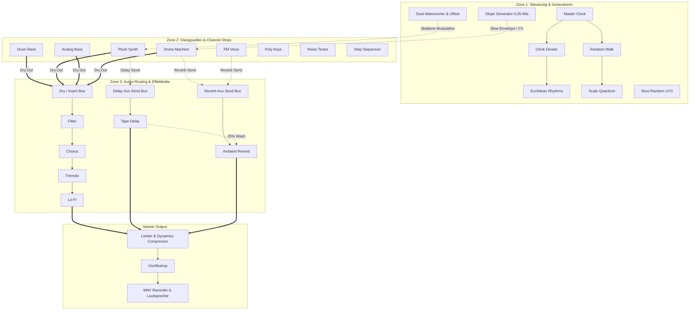

# ⚡ SYNTHBOARD STUDIO – Das vollständige Handbuch & Dokumentation

> **Modulares Ambient-Rack & Eurorack-Synthesizer im Browser**  
> Kombiniert freies, modulares Kabel-Patching (Clock, Gates, 1V/Okt Pitch CV und fließende Modulation) mit einer parallelen Stimmenarchitektur und einer frei sortierbaren Stereo-Effektkette.

---

## Inhaltsverzeichnis

1. [Überblick & Architektur](#1-überblick--architektur)
2. [Modulares Patch-Kabel-System (Kabel verbinden)](#2-modulares-patch-kabel-system-kabel-verbinden)
3. [Die 3 Rack-Zonen und der Signalfluss](#3-die-3-rack-zonen-und-der-signalfluss)
4. [Detailliertes Modul-Lexikon (Alle 30 Module)](#4-detailliertes-modul-lexikon-alle-30-module)
   - [Steuerung & Generatoren (11 Module)](#a-steuerung--generatoren)
   - [Klangquellen & Stimmen (13 Module)](#b-klangquellen--stimmen)
   - [Effektkette (6 Module)](#c-effektkette)
5. [Interaktives Hilfesystem & Infoboxen](#5-interaktives-hilfesystem--infoboxen)
6. [Board-Verwaltung, Aufnahme & System-Features](#6-board-verwaltung-aufnahme--system-features)
7. [Praxis-Rezepte zum Nachbauen](#7-praxis-rezepte-zum-nachbauen)
8. [Tastatur-Kürzel & Schnellbedienung](#8-tastatur-kürzel--schnellbedienung)

---

## 1. Überblick & Architektur

SYNTHBOARD ist als modulares Studio-Rack konzipiert. Es trennt musikalische Steuerungslogik, Klangerzeugung und Klangverarbeitung in klar strukturierte Ebenen:

* **Kein fest verdrahteter Zwang:** Instrumente können völlig frei über Steuerkabel getriggert oder manuell gespielt werden.
* **Separater Aux-Effektweg:** Jedes Instrument besitzt einen eigenen Studio-Kanalzug mit **Pan**, **Delay Send** und **Reverb Send**, wodurch z. B. Bass und Drums knackig und trocken bleiben, während Drones und Harfen im Hallraum schweben.
* **Web Audio DSP:** Alle Synthese- und Modulationsberechnungen laufen in 64-Bit-Gleitkomma mit Sample-Akkuratesse im Web Audio Subsystem.

---

## 2. Modulares Patch-Kabel-System (Kabel verbinden)

Das Kabelsystem simuliert ein physisches Hardware-Eurorack mit elastischen Kabeln, Ein- und Aussteck-Animationen sowie optischer Signal-Aktivität.

### Kabel verbinden & trennen
1. **Kabel ziehen:** Klicke mit der linken Maustaste auf eine beliebige Buchse (Eingang oder Ausgang), halte die Maustaste gedrückt und ziehe das Kabel zur gewünschten Gegenbuchse. Sobald du loslässt, schnappt das Kabel ein.
2. **Kabel trennen:** 
   - **Rechtsklick** auf eine belegte Buchse trennt die Verbindung sofort.
   - Alternativ kannst du das Kabelende mit der linken Maustaste greifen und ins Leere fallen lassen.
3. **Eurorack-Verbindungsregel:**
   - **Ausgänge (OUT)** dürfen ihr Signal an *beliebig viele* Eingänge gleichzeitig senden (Multing / Signalverzweigung).
   - **Eingänge (IN)** empfangen im Studio-Standard jeweils *genau 1* Signal, um Phasen- und Pegelkonflikte zu vermeiden.
4. **Kabel ausblenden:** 
   - Klicke oben auf **`KABEL`** (oder drücke Taste **`C`**). Alle Kabel werden ausgeblendet, während die Audio-Verbindungen unbeeinflusst weiterlaufen.
5. **Modulationsstärke pro Kabel (Depth):**
   - Jedes Modulationskabel (`MOD`, grün) besitzt eine interaktive **Stärke-Plakette** (0 % bis 200 %).
   - **Ziehen nach oben/unten** oder **Mausrad** über der Plakette reguliert die Modulationsintensität.
   - **Doppelklick** setzt sofort auf 100 % (volle Übertragung) zurück.

### Die 4 Signaltypen & Farbcodes

| Farbe | Signal | Typ | Verwendung & Verhalten |
| :--- | :--- | :--- | :--- |
| **Cyan** `#06b6d4` | **CLOCK** | Takt / Sync | Kontinuierliche Taktschläge (1/16, 1/8, Viertel, Ganztakt). Hält Sequenzer, Teiler und Rhythmen im gemeinsamen Tempo. |
| **Gold** `#fbbf24` | **GATE / TRIG** | Impuls | Kurze Trigger-Stöße (10–100 ms). Löst Notenanschläge in Zupf-Synths, Keys oder Drums aus. |
| **Lila** `#a855f7` | **PITCH CV** | Tonhöhe | 1V/Oktave-Standard. Überträgt Tonhöhen (MIDI-Note 0–127) an Synths, Bässe und Quantisierer. |
| **Grün** `#10b981` | **MODULATION** | Steuerspannung | Kontinuierliche Wellenformen (0.0 bis 1.0) von LFOs, Rauschen oder Makro-Fadern für dynamische Klangfarben. |

---

## 3. Die 3 Rack-Zonen und der Signalfluss

### Zone 1: Steuerung & Generatoren (Oben)
* Beherbergt Taktgeneratoren, Euklidische Rhythmen, Zufallsgeneratoren, Tonhöhen-Quantisierer, Funktions-/Hüllkurven-Generatoren (**Slope Generator**) und Bipolare Abschwächer (**Attenuverter & Offset**).
* Erzeugt keine direkten Töne, sondern steuert über Buchsen die Klangerzeuger und Effektparameter der unteren Zonen.

### Zone 2: Klangquellen & Studio-Kanalzüge (Mitte)
* Beherbergt Synthesizer, Drones, Bässe, Drum-Machines und Rauschgeneratoren.
* **Integrierter Studio-Kanalzug pro Instrument:**
  - **`PAN`**: Platziert die Stimme im Stereofeld (-100% links bis +100% rechts). Steuerbar auch extern über die Buchse `PAN CV`.
  - **`DELAY SEND`**: Bestimmt stufenlos (0–100%), wie viel Signalanteil der Stimme in das Tape Delay gelangt.
  - **`REVERB SEND`**: Bestimmt stufenlos (0–100%), wie viel Signalanteil in den Ambient Reverb geschickt wird.
  - **`VCA CV`**: Modulations-Eingang für dynamische Lautstärkeverläufe (z. B. 40-Sekunden-Swells per Slope Generator). Ohne gestecktes Kabel gilt die manuelle Lautstärke.

### Zone 3: Effektkette & Aux-Routing (Unten)
* **Serielle Insert-Effekte:** Filter ➜ Chorus ➜ Tremolo ➜ Lo-Fi Bitcrusher bearbeiten das direkte Stereosignal.
* **Parallele Aux-Effekte (Tape Delay & Ambient Reverb):** Werden über die separaten Send-Busse der Stimmen angesteuert. Ein Teil des Delay-Ausgangs (25%) wird automatisch zusätzlich in den Hall eingespeist („Wash-Effekt“).
* **Reihenfolge ändern:** Ziehe Effekte an der Kopfzeile per Drag & Drop an eine andere Position oder nutze die Pfeile **`◀`** und **`▶`**.
* **Bypass:** Jeder Effekt besitzt einen An/Aus-Schalter mit LED (`pled`), um ihn verzögerungsfrei zu umgehen.

---

## 4. Detailliertes Modul-Lexikon (Alle 24 Module)

### A. Steuerung & Generatoren

#### 1. Master Clock (`⏱`)
* **Aufgabe:** Zentraler Taktgeber für das gesamte Studio-Rack.
* **Regler:**
  - `Tempo`: 40 bis 200 BPM.
  - `Swing`: Verzögert ungerade 16tel-Schläge für jazzigen/shuffelnden Groove (0–60%).
* **Optionen:** Transport (`▶ Läuft` / `■ Pause`).
* **Buchsen:**
  - `1/16` (Clock Out): Schnelle Sechzehntel-Taktschläge.
  - `1/8` (Clock Out): Achtel-Impulse.
  - `1/4` (Clock Out): Viertel-Takte (Metronom).
  - `1 BAR` (Clock Out): Ein Impuls pro 4/4-Takt.
  - `RESET` (Gate Out): Impuls bei Taktbeginn oder Neustart.

#### 2. Clock Divider (`➗`)
* **Aufgabe:** Teilt eingehende Clock-Signale in musikalische Unterteilungen.
* **Regler:** `Teiler A`, `Teiler B`, `Teiler C`, `Teiler D` (wählbar von /1 bis /16).
* **Buchsen:**
  - `CLOCK IN`: Empfängt den Master-Takt.
  - `RESET IN`: Setzt alle Teiler synchron auf Null.
  - `OUT A`–`OUT D`: Unabhängig geteilte Taktimpulse.

#### 3. Euclidean Rhythm (`⭕`)
* **Aufgabe:** Generiert mathematisch verteilte Polyrhythmen nach dem Björklund-Algorithmus (bekannt aus afrikanischen und lateinamerikanischen Rhythmen).
* **Regler:**
  - `Steps`: Gesamtlänge des Zyklus (1 bis 32 Schritte).
  - `Hits`: Anzahl der rhythmischen Schläge im Zyklus.
  - `Rotate`: Verschiebung des Startpunkts im Kreis (0 bis 16).
* **Buchsen:**
  - `CLOCK IN`: Schreitet pro Impuls einen Schritt voran.
  - `RESET IN`: Springt sofort auf Schritt 1.
  - `GATE OUT`: Euklidische Rhythmus-Impulse.
  - `ACCENT OUT`: Betonter Impuls auf Schlag 1.

#### 4. Probability Gate (`🎲`)
* **Aufgabe:** Bernoulli-Gate / Zufallswürfel zur Erzeugung lebendiger, unvorhersehbarer Trigger-Muster.
* **Regler:**
  - `Chance A`: Wahrscheinlichkeit in %, mit der ein Impuls an Ausgang A gesendet wird.
  - `Chance B`: Wahrscheinlichkeit für Ausgang B.
* **Buchsen:**
  - `GATE IN`: Eingehender Trigger.
  - `A OUT`: Zufallsausgang A.
  - `B OUT`: Zufallsausgang B.
  - `ALT OUT`: Alternierender Ausgang (wechselt bei Treffern zwischen zwei Pfaden).

#### 5. Random Walk (`🐾`)
* **Aufgabe:** Generativer Zufalls-Melodiegenerator nach dem Prinzip der Brownschen Bewegung (Zufallsschritte nach oben/unten).
* **Regler:**
  - `Step Size`: Maximale Intervall-Sprungweite (1 bis 5 Halbtöne).
  - `Smooth`: Gleitzeit (Portamento) zwischen zwei Tonhöhen (0 bis 500 ms).
  - `Range`: Gesamter Tonumfang (1 bis 4 Oktaven).
* **Optionen:** `Grundton` (C bis B), `Skala` (Moll, Dur, Dorisch etc.).
* **Buchsen:**
  - `STEP IN`: Triggert den nächsten Notenschritt.
  - `RESET IN`: Springt auf den Grundton zurück.
  - `PITCH CV`: 1V/Okt Notenspannung.
  - `GATE OUT`: Trigger-Puls bei jedem Notenschritt.

#### 6. Scale Quantizer (`🎯`)
* **Aufgabe:** Zwingt frei schwebende, kontinuierliche CV-Spannungen exakt auf vordefinierte musikalische Tonleitern.
* **Regler:** `Transpose` (Halbton-Transponierung um ±12 Halbtöne).
* **Optionen:** `Grundton` (C bis B), `Skala` (Moll Penta, Dur Penta, Dorisch, Moll, Dur, Hirajoshi).
* **Buchsen:**
  - `PITCH IN`: Unquantisierte Eingangsspannung.
  - `LATCH`: Taktet das Einfrieren des aktuellen Werts.
  - `PITCH OUT`: Skalenreine Tonhöhenspannung (1V/Okt).
  - `GATE OUT`: Trigger-Impuls bei jeder erkannten neuen Tonstufe.

#### 7. Slow Random LFO (`〰`)
* **Aufgabe:** Organisch driftende Modulationsquelle und Sample & Hold Rauschgenerator.
* **Regler:**
  - `Rate`: Modulationsfrequenz (0.01 bis 4 Hz).
  - `Smooth`: Glättungszeit der Flanken.
  - `Tiefe`: Modulationshub (0 bis 100%).
* **Buchsen:**
  - `S&H CLK`: Taktet die Sample-and-Hold-Stufe ab.
  - `SMOOTH CV`: Fließende, geschmeidige Steuerspannung.
  - `STEP CV`: Gestufte, kantige Treppenspannung.

#### 8. Macro Controller (`🎚`)
* **Aufgabe:** Vier Master-Modulationsregler für die zentrale Handsteuerung mehrerer Parameter im Rack.
* **Regler:** `Macro 1`, `Macro 2`, `Macro 3`, `Morph`.
* **Buchsen:** `M1 CV`, `M2 CV`, `M3 CV`, `MORPH CV`.

#### 9. Slope Generator (`⋀`)
* **Aufgabe:** Modulares Funktions- und Hüllkurven-Modul (inspiriert vom Eurorack-Klassiker *Make Noise Maths*). Erzeugt extrem flexible Modulationsspannungen für Ambient-Pufferspeicher, LFOs und langsame Wellenbewegungen von 0.05 Sekunden bis zu 60 Sekunden pro Zyklus.
* **Regler & Schalter:**
  - `Rise`: Anstiegszeit (0.05s bis 60s, logarithmisch skaliert).
  - `Fall`: Abfallzeit (0.05s bis 60s, logarithmisch skaliert).
  - `Curve`: Flankenform stufenlos von logarithmisch über linear bis exponentiell (`log / lin / exp`).
  - `Mode`: Betriebsmodus:
    - `loop`: Zyklischer LFO (startet nach Erreichen des Minimalwerts sofort wieder neu).
    - `trig`: Attack-Decay-Hüllkurve (schließt nach Trigger-Puls immer den kompletten Zyklus ab).
    - `gate`: Attack-Sustain-Release-Hüllkurve (bleibt auf Maximum, solange das Gate anliegt).
  - `Scale`: Bipolare Abschwächung / Invertierung des Ausgangs (-100% bis +100%).
  - `Offset`: Gleichspannungs-Offset (-1.0 bis +1.0) zum Anheben oder Absenken der Modulation.
* **Buchsen:**
  - `TRIG IN`: Startet den Zyklus bei einem eingehenden Puls neu.
  - `GATE IN`: Hält die Hüllkurve auf Maximum im `gate`-Modus.
  - `MOD RISE`: Steuerspannung zur dynamischen Modulation der Anstiegszeit.
  - `MOD FALL`: Steuerspannung zur dynamischen Modulation der Abfallzeit.
  - `ENV OUT`: Normale positive Hüllkurvenspannung (skaliert und versetzt).
  - `INV OUT`: Invertierte Steuerspannung (ideal für gegenläufige Modulationen).
  - `EOC OUT`: End-of-Cycle Triggerpuls, sobald der Zyklus beendet ist (ideal zur Kaskadierung!).

#### 10. Attenuverter & Offset (`⧉`)
* **Aufgabe:** Zweikanaliges Steuerungsmodul zum präzisen Abschwächen, Invertieren, Versetzen und Summieren von Modulationsspannungen. Verhindert, dass zu starke CV-Kabel Parameter überreißen.
* **Regler:**
  - `Scale A` / `Scale B`: Bipolare Verstärkung (-100% bis +100%). Bei negativen Werten wird die Modulation invertiert.
  - `Offset A` / `Offset B`: Gleichspannungs-Offset (-1.0 bis +1.0).
* **Buchsen:**
  - `IN A` / `IN B`: Zu dosierende Steuerspannungen.
  - `OUT A` / `OUT B`: Skalierte und versetzte Ausgangsspannungen.
  - `SUM OUT`: Addiert Kanal A + Kanal B (Modulations-Mischer).

#### 11. Scene Conductor (`🎬`)
* **Aufgabe:** Zentraler musikalischer Szenen- und Genre-Dirigent. Wechselt fließend oder hart zwischen 4 Genres: **Ambient** (freie Impulse, weite Räume), **Downtempo** (weicher Beat & Bass), **Broken Beat** (synkopierte Percussion) und **Techno** (stramme 4/4 Kick und pulsierende Energie).
* **Regler & Optionen:**
  - `Stärke`: Einfluss des Conductor-Wechsels (0.1 bis 1.0).
  - `Dichte`: Rhythmus- und Schlagdichte (0.3× bis 1.6×).
  - `Variation`: Zufällige Geister- und Akzentschläge.
  - `Mutation`: Stärke zufälliger Musterveränderungen.
  - `Wann`: Quantisierung des Wechsels (`Sofort`, `Nächster Schlag`, `Nächster Takt`, `Nächste Phrase`).
  - `Wie`: Überblendzeit (`Harter Wechsel`, `1 Takt`, `2 Takte`, `4 Takte`, `8 Takte`).
  - `Was`: Wechselbereich (`Ganze Szene`, `Nur Rhythmus`, `Nur Klangfarben`).
  - `Auto-Wechsel`: Automatischer zyklischer Wechsel (`Aus`, alle 4/8/16/32 Takte).
  - `Break-Länge`: Dauer des Breaks (1, 2 oder 4 Takte).
  - `Hall folgt`: Automatisches Anpassen der Raum-Effekte an die Szene (`Aus`, `Hall & Delay`).
* **Interaktives UI:** 4 Szenen-Taster, 16-Step-Gitter pro Spur (Kick, Snare, Hat, Perc, Bass, Lead) mit Stummschaltung und Spur-Sperren (🔒).
* **Buchsen:**
  - `CLOCK IN`: Takt-Eingang für quantisierte Wechsel.
  - `NEXT SCENE` / `RETURN`: Trigger für Vor- und Rücksprung zwischen Szenen.
  - `FILL`: Löst ein dynamisches Drum-Fill bis Taktende aus.
  - `BREAK`: Nimmt Kick & Bass heraus; Hall und Flächen wachsen für einen dramatischen Drop an.
  - `MUTATE`: Würfelt die Rhythmusmuster der Szene neu.
  - `KICK`, `SNARE`, `HAT`, `PERC`, `BASS GATE`, `BASS PITCH`, `LEAD GATE`, `LEAD PITCH`: Rhythmus- und Melodie-Ausgänge.
  - `CHANGE`: Impuls bei jedem Szenenwechsel oder Drop nach einem Break.
  - `PAD`, `CLOUD`, `ENERGY`, `SPACE`, `TIMBRE`: 5 dynamische Steuerspannungen (0.0 bis 1.0).
  - `SCENE`: Stufenloser Gesamtindex der Szene.

---

### B. Klangquellen & Stimmen

> **Studio-Kanalzug:** Jede Stimme verfügt über Regler für **PAN**, **DELAY SEND** und **REVERB SEND** sowie über **`VCA CV`** (Pegelmodulation) und **`PAN CV`** (Stereomodulation).

#### 11. Drone Machine (`🪐`)
* **Aufgabe:** 6-stimmiger organischer Drone-Generator für tiefe, kosmische Klangteppiche.
* **Regler:** `Level`, `Tone` (Filter), `Spread` (Verstimmung), `FM` (Frequenzmodulation), `Drift` (Langsames analoges Schwingen).
* **Pads:** 6 interaktive Oszillator-Tasten zum individuellen Ein- und Ausschalten jeder Teilstimme.
* **Buchsen:** `GATE IN` (Swell-Trigger), `FILTER CV`, `SPREAD CV`, `VCA CV`, `PAN CV`.

#### 12. Pluck Synth (`🪕`)
* **Aufgabe:** Physical-Modeling / Karplus-Strong Synthesizer für akustische Harfen-, Kalimba- und Glockenklänge.
* **Regler:** `Level`, `Tone` (Dämpfungsfilter), `Decay` (Ausklingzeit), `Oberton`, `Body` (Resonanzkörper).
* **Buchsen:** `GATE IN` (Anschlag), `PITCH IN` (1V/Okt), `FILTER CV`, `VCA CV`, `PAN CV`.

#### 13. FM Voice (`🔔`)
* **Aufgabe:** 2-Operatoren Frequenzmodulations-Stimme für helle metallische Töne, Bells und E-Pianos.
* **Regler:** `Level`, `Ratio` (Frequenzverhältnis Träger/Modulator), `Index` (FM-Tiefe/Helligkeit), `Attack`, `Decay`.
* **Buchsen:** `GATE IN` (Anschlag), `PITCH IN`, `FM INDEX CV`, `VCA CV`, `PAN CV`.

#### 14. Analog Bass (`⚡`)
* **Aufgabe:** Monophoner Acid-/Sub-Bass Synthesizer mit saftigem Tiefpassfilter.
* **Regler:** `Level`, `Cutoff`, `Resonanz`, `Env Mod` (Filterhüllkurven-Tiefe), `Decay`, `Glide` (Portamento).
* **Optionen:** `Wellenform` (Sägezahn / Rechteck), `Sub-Oktave` (-1 Okt / -2 Okt).
* **Buchsen:** `GATE IN`, `PITCH IN`, `CUTOFF CV`, `VCA CV`, `PAN CV`.

#### 15. Drum Rack (`🥁`)
* **Aufgabe:** 4-Kanal analoger Drum-Synthesizer mit Kick, Snare, Hi-Hat und Percussion.
* **Regler:** `Kick Pitch`, `Kick Decay`, `Snare Snap`, `Snare Tune`, `HH Decay`, `Perc Pitch`.
* **Pads:** 4 spielbare Trigger-Pads (`KICK`, `SNARE`, `HI-HAT`, `PERC`).
* **Buchsen:** `KICK IN`, `SNARE IN`, `HH IN`, `PERC IN`, `VCA CV`, `PAN CV`.

#### 16. Poly Keys (`🎹`)
* **Aufgabe:** Polyphoner Synthesizer für Pads, Chords und Melodien.
* **Regler:** `Level`, `Cutoff`, `Reso`, `Attack`, `Release`, `Detune`.
* **Optionen:** `Welle` (Dreieck, Sägezahn, Rechteck), `Skala`, `Grundton`, `Oktave`.
* **Tastatur:** Kann direkt mit Computertasten **`A`–`K`** gespielt werden.
* **Buchsen:** `GATE IN`, `PITCH IN`, `FILTER CV`, `VCA CV`, `PAN CV`.

#### 17. Step Sequencer (`∿`)
* **Aufgabe:** 8-Schritt Melodie- und Gate-Sequenzer.
* **Regler:** `Tempo`, `Swing`, `Gate Len`, `Decay`, sowie 8 individuelle Schritt-Regler für die Tonhöhe.
* **Optionen:** `Schritte` (1–8), `Skala`, `Grundton`, `Oktave`.
* **Buchsen:** `CLOCK IN`, `GATE OUT`, `PITCH OUT`, `VCA CV`, `PAN CV`.

#### 18. Noise Textur (`≋`)
* **Aufgabe:** Rauschgenerator für Meeresrauschen, Windeffekte und analoges Vinyl-Knistern.
* **Regler:** `Level`, `Tone`, `Reso`, `Wind` (Modulation), `Speed`, `Vinyl` (Knistern).
* **Optionen:** `Farbe` (Pink / Weiß), `Filter` (Lowpass, Bandpass, Highpass).
* **Buchsen:** `VCA CV`, `PAN CV`.

#### 19. Morph Voice (`🌀`)
* **Aufgabe:** Vielseitige Hauptstimme mit fließend morphenden Wellenformen (virtuell analog, 8-stufige Wavetables, FM, Rauschen, Formant-Filter).
* **Klangwelten:** Dunkle warme Flächen, chorähnliche Vokale, aggressive Bässe, metallische Glöckchen oder digitale Zupfklänge.
* **Regler:** `Level`, `Morph`, `Helligkeit`, `Formant`, `Rauheit`, `Verstimmung`, `Attack`, `Release`, `Stimmen`, `Sprung`, `Velocity`, `Mutation`.
* **Buchsen:** `GATE`, `PITCH`, `JUMP` (wählt zufällige Wellenformposition), `MORPH CV`, `TIMBRE CV`, `ENV CV`, `VCA CV`, `PAN CV`, `MUTATE`.

#### 20. Hybrid Percussion (`🪘`)
* **Aufgabe:** Formbare analog-digitale Trommelstimme. Vereint Tonkörper (Kick/Tom), rauschige Snare-Teppiche, metallische Glocken/Hats und Klick-Transienten.
* **Regler:** `Level`, `Tonhöhe`, `Körper`, `Material`, `Tonabfall`, `Rauschen`, `Anschlag`, `Länge`, `Verzerrung`, `Velocity`, `Mutation`.
* **Schnellwahltasten:** `TIEF`, `TOM`, `SNARE`, `METALL`.
* **Buchsen:** `GATE`, `PITCH`, `MATERIAL CV`, `LENGTH CV`, `VCA CV`, `PAN CV`, `MUTATE`.

#### 21. Resonator Garden (`🔔`)
* **Aufgabe:** Physikalisch modellierte gestimmte Resonanzen. Aus Impulsen, Klicks oder Rauschen entstehen Saiten, Glocken, Gongs, Holzstäbe und stehende Drones.
* **Regler:** `Level`, `Material`, `Größe`, `Dämpfung`, `Anschlagposition`, `Verteilung`, `Ausklang`, `Resonanzen`, `Velocity`, `Mutation`.
* **Optionen:** `Anregung` (`Impuls`, `Rauschen`, `Dauer`).
* **Buchsen:** `GATE`, `PITCH`, `MATERIAL CV`, `DAMP CV`, `VCA CV`, `PAN CV`, `MUTATE`.

#### 22. Granular Cloud (`☁`)
* **Aufgabe:** Zerlegt Audio in Mikrokörner (Grains). Verwandelt jede Aufnahme in dichte Ambient-Klangwolken oder zerhackte rhythmische Percussion.
* **Quellen:** Vokal-Chor, Regen, Klavier, Maschinenraum oder eigene Audio-Dateien / Live-Mitschnitte des Masters per Mikro/Recorder.
* **Regler:** `Level`, `Position`, `Korngröße`, `Dichte`, `Tonhöhe`, `Rückwärts`, `Zeitstreuung`, `Stereobreite`, `Scan`, `Sprung`, `Velocity`, `Mutation`.
* **Optionen:** `Spielweise` (`Cloud` für endlose Fläche, `Trigger` für Beat-Impulse).
* **Buchsen:** `GATE`, `JUMP`, `FREEZE`, `PITCH`, `POS CV`, `DENSITY CV`, `VCA CV`, `PAN CV`, `MUTATE`.

#### 23. Spectral Swarm (`✺`)
* **Aufgabe:** Schwarm aus bis zu 32 unabhängigen Sinus-Teiltönen mit organischer Bewegung, Wanderung und Stereoverteilung.
* **Besonderheit:** **`SCATTER`** verteilt die Teiltöne im Frequenz- und Stereoraum; **`GATHER`** zieht sie zu einem reinen, harmonischen Akkord zusammen.
* **Regler:** `Level`, `Teiltöne`, `Unharmonik`, `Streuung`, `Bewegung`, `Tiefe`, `Helligkeit`, `Zusammenhalt`, `Hüllkurve`, `Velocity`, `Mutation`.
* **Optionen:** `Modus` (`Drone` für schwebende Cluster, `Partikel` für glockenartige Schwärme).
* **Buchsen:** `GATE`, `PITCH`, `SCATTER`, `GATHER`, `COHESION CV`, `VCA CV`, `PAN CV`, `MUTATE`.

---

### C. Effektkette

#### 19. Analog Filter (`⌇`)
* **Aufgabe:** 24dB-Multimode-Klangfilter mit analoger Sättigung (Drive) und eigenem LFO-Sweep.
* **Regler:** `Cutoff`, `Reso`, `Drive`, `LFO Rate`, `LFO Tiefe`.
* **Optionen:** Typ (`Lowpass`, `Highpass`, `Bandpass`).
* **Buchsen:** `CUTOFF CV` (Externe Filtermodulation).

#### 20. Stereo Chorus (`🌊`)
* **Aufgabe:** Erzeugt räumliche Breite, Stereo-Verdopplung und schwebenden Ensemble-Klang.
* **Regler:** `Rate`, `Tiefe`, `Delay`, `Mix`.

#### 21. Tremolo (`〰`)
* **Aufgabe:** Periodische optische Lautstärkemodulation für Vintage-Sounds.
* **Regler:** `Rate`, `Tiefe`.

#### 22. Lo-Fi Bitcrusher (`📼`)
* **Aufgabe:** Digitale Bit-Reduktion, Sampleraten-Herabsetzung und Tonband-Flutter.
* **Regler:** `Bits` (1–16 Bit), `Sample Rate`, `Drive`, `Flutter`, `Mix`.

#### 23. Tape Delay (`🪞`)
* **Aufgabe:** Warmes analoges Band-Echo mit getrennten Stereopfaden.
* **Regler:** `Zeit`, `Feedback`, `Tone` (Höhendämpfung), `Wobble`, `Mix`.
* **Optionen:** Modus (`Stereo` / `Ping-Pong`).
* **Buchsen:** `TIME CV` (Warp- und Pitch-Modulation der Echozeit).

#### 24. Ambient Reverb (`✨`)
* **Aufgabe:** Shimmernder, tiefer Hallraum mit hoher Dichte für Ambient-Flächen.
* **Regler:** `Decay` (Nachhallzeit bis 20s), `Dämpfung`, `Pre-Delay`, `Tone`, `Mix`.

---

## 5. Interaktives Hilfesystem & Infoboxen

1. **Infoboxen Ein/Aus (`INFO: AN / AUS`):**
   - Schalter oben in der Topbar oder per Shortcut **`I`**.
   - Hover über eine Buchse blendet eine schwebende Box mit Typ (IN/OUT), Signalart, Beschreibung und aktiven Verbindungen ein.
   - Hover über Regler erklärt deren physikalische und klangliche Funktion.
   - Wenn deaktiviert: Reines, ablenkungsfreies Arbeiten ohne Popups.
2. **Modul-Hilfebuttons (`?`):**
   - Jede Modulkarte verfügt über einen `?`-Button in der Kopfzeile, der direkt das Handbuch öffnet und das Modul anzeigt.
3. **Studio-Handbuch:**
   - Klick auf **`HANDBUCH`** in der Menüleiste (oder Taste **`H`** / **`?`**).
   - Mit Volltextsuche und Kategorie-Filtern (`Alle`, `Steuerung`, `Klangquellen`, `Effekte`).

---

## 6. Board-Verwaltung, Aufnahme & System-Features

* **Boards speichern & laden:**
  - Standard-Vorlagen: *Generatives Ambient*, *Solar Drone Desk*, *Ambient Sequenz*, *Lo-Fi Keys & FM*, *Leeres Board*.
  - Eigene Boards speichern (`💾 Speichern`) oder duplizieren (`⧉ Kopie`).
  - **Export / Import:** Boards als Datei herunterladen (`⇩`) oder von der Festplatte einlesen (`⇧`).
* **Studio-WAV-Aufnahme (`REC`):**
  - Schneidet den Master-Ausgang unkomprimiert in Studioqualität mit.
  - Klick auf `STOP` speichert die `.wav`-Datei sofort auf deiner Festplatte.
* **Master Oszilloskop:** Live-Waveform-Anzeige mit 60 FPS direkt in der oberen Leiste.
* **Audio-Watchdog (Überlaufschutz):**
  - Überwacht die Master-Summe kontinuierlich auf `NaN` (Not-a-Number), unendliche Rückkopplungsschleifen oder Pegelübersteuerungen.
  - Setzt die Audio-Engine bei Ausnahmefällen automatisch sanft zurück, ohne dass die Benutzeroberfläche neu geladen werden muss.

---

## 7. Praxis-Rezepte zum Nachbauen

### 🌿 Rezept 1: Generative Ambient-Harfe
1. Füge **Master Clock**, **Euclidean Rhythm**, **Random Walk** und **Pluck Synth** hinzu.
2. Verbinde `Master Clock: 1/16` ➜ `Euclidean: CLOCK IN`.
3. Verbinde `Euclidean: GATE OUT` ➜ `Random Walk: STEP IN`.
4. Verbinde `Random Walk: PITCH CV` ➜ `Pluck Synth: PITCH IN`.
5. Verbinde `Euclidean: GATE OUT` ➜ `Pluck Synth: GATE IN`.
6. Schalte in der Effektkette **Tape Delay** und **Ambient Reverb** ein.
7. *Ergebnis:* Ein unendliches, wunderschönes Zupfmuster, das sich nie exakt wiederholt.

### 🥁 Rezept 2: Polyrhythmische Beats & Acid-Bass
1. Füge **Master Clock**, **Clock Divider**, **Euclidean Rhythm**, **Drum Rack** und **Analog Bass** hinzu.
2. Verbinde `Master Clock: 1/16` ➜ `Clock Divider: CLOCK IN`.
3. Verbinde `Clock Divider: /4` ➜ `Drum Rack: KICK IN` (Gerader 4/4 Beat).
4. Verbinde `Clock Divider: /8` ➜ `Drum Rack: SNARE IN` (Snare auf 2 und 4).
5. Verbinde `Master Clock: 1/16` ➜ `Euclidean: CLOCK IN` (z. B. Steps=7, Hits=3) ➜ `Drum Rack: HI-HAT IN`.
6. Verbinde `Clock Divider: /2` ➜ `Analog Bass: GATE IN`.

### 🌊 Rezept 3: Organisch atmender Filter-Sweep
1. Füge **Slow Random LFO** und **Analog Filter** hinzu.
2. Verbinde `Slow Random: SMOOTH CV` ➜ `Analog Filter: CUTOFF CV`.
3. Stelle `Rate` auf 0.08 Hz und `Tiefe` auf 65%.
4. *Ergebnis:* Das Filter öffnet und schließt sich langsam wie eine Meereswelle.

### 🌌 Rezept 4: 40s Ambient Swell & Getrennte FX-Sends
1. Füge **Slope Generator** und **Drone Machine** hinzu.
2. Setze den Slope Generator auf Modus `loop`, `Rise` auf 12s und `Fall` auf 28s.
3. Verbinde `Slope Generator: ENV OUT` ➜ `Drone Machine: VCA CV`.
4. Drehe an der Drone Machine den **REVERB-Send** auf 75% und den **DELAY-Send** auf 35%.
5. *Ergebnis:* Die Drone schwillt über 40 Sekunden majestätisch an und verhallt in der Ferne, während andere Instrumente wie Bass oder Percussion vollkommen trocken und druckvoll im Vordergrund verweilen.

---

## 8. Tastatur-Kürzel & Schnellbedienung

| Taste | Aktion |
| :--- | :--- |
| **`I`** | **Infoboxen an- / ausschalten** |
| **`H`** oder **`?`** | **Studio-Handbuch öffnen / schließen** |
| **`C`** | **Patch-Kabel ein- / ausblenden** |
| **`A` bis `K`** | Poly Keys Synthesizer live auf der Computertastatur spielen |
| **`Esc`** | Handbuch oder modale Dialoge schließen |
| **Doppelklick auf Regler** | Regler sofort auf seinen Standardwert zurücksetzen |
| **Rechtsklick auf Buchse** | Kabel von der Buchse trennen |

---
*SYNTHBOARD Studio © 2026 – Modulare Synthese im Browser*
